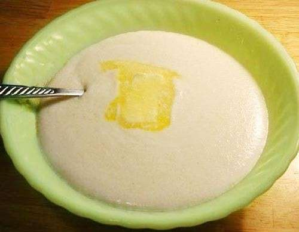
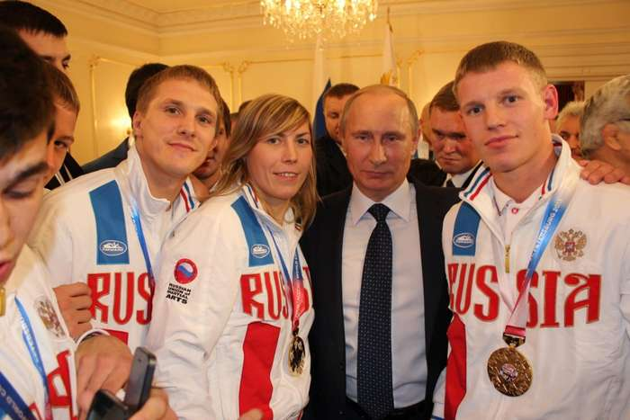

# WADA-Хүүхдийн будааны агшаамлыг,  допингийн хэмжээнд авч үзэж, хориотой бэлдмэлийн жагсаалтад оруулав

Гудамжинд, эргэлзээтэй булан тохойд, “каш” байна уу... чиш... хэд вэ?... байз ... цагдаа... гэсэн хачин сонин үйлдлүүд гарах нь уу???

Допингийн эсрэг олон улсын байгууллага WADA, хүүхдийн будааны агшаамал буюу, бидний хэлж заншсанаар “каш”-г, допингийн үйлчлэлтэй хориотой бэлдмэлийн жагсаалтад, албан ёсоор оруулав. Учир нь, Оросын ерөнхийлөгч Владмир Путин, хэлсэн үгэндээ улс төр, спортын сэтгэлд хүрсэн амжилтууд маань, өөрсдийн маань хүчин зүтгэлээс гадна, өдөр тутмын хэрэглээ, бие мах бод, оюун ухааны үйл ажиллагааг дэмжин, ажилллах чадварыг өсгөдөг хүүхдийн будааны агшаамал “”каш”-тай холбоотой гэж дурдсантай холбоотой юм байна. Тэрээр, зуны олимпын өмнөхөн, тамирчидтай хийсэн уулзалт дээр,”хүүхдийн будаанд 70% агуулагддаг нүүрс ус нь, бие мах бодийн үйл ажиллагааг идэвхжүүлдэг, сэтгэл санаанд сайнаар нөлөөлдөг учраас энэхүү амттай, ашигтай хоолыг, би хүмүүст хэрэглэхийг байнга санал болгодог, мөн манай тамирчид ч, өндөр амжилтад хүрэхийн тулд, мөн идэж занших хэрэгтэй” гэж хэлсэн ажээ.\
Допингийн эсрэг олон улсын байгууллагаас, энэ хорио, зөвхөн оросын тамирчидад ч бус бүх улсад ижил үйлчилнэ гэсэн бөгөөд энэ хориог, АНУ-н зүгээс тавьсан хүсэлтийн дагуу хийснээ, нуухгүй байгаа юм.

Ийнхүү, бидний дуртай өглөөний хоол, “каш”, өндөр амжилтад хүргэдэг увидастай байх нь ээ...
