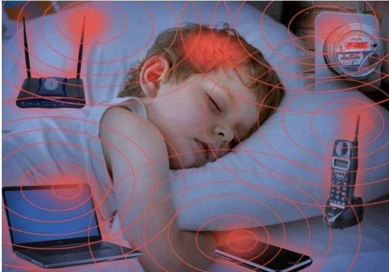
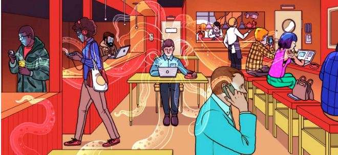

# Wi-Fi  –н  эрүүл мэндэд нөлөөлөх үр дагавар

Утасгүй интернет, Wi-Fi –г хүн бүр, өргөнөөр ашиглаж байгаа билээ. Гэтэл Wi-Fi –н үйлчилгээний оффист ажиллагсад, Wi-Fi төхөөрөмжиийн хор хөнөөлөөс эрүүл мэндээ хамгаалах, тусгай зааварчилгыг мөрдөн ажилладаг.

#### Wi-Fi: хүмүүсийг удаанаар үгүй хийх, чимээгүй алуурчин:

Утасгүй интернетийн төхөөрөмжүүд болон, гар утас, Tablet зэрэгт, чиглүүлэгч төхөөрөмж ашиглагддаг. Энэхүү төхөөрөмж нь, WLAN дохиолол цацдаг бөгөөд, энэ нь хүний бие организмд маш муу нөлөөлдөг байна.\
Энэ дохиолол, Wi-Fi асаалттай байх хугацаанд, тасралтгүй үйлчилж байдаг байна.\
Английн эрүүл мэндийн байгууллагын судалгаагаар, Wi-Fi -н чиглүүлэгч нь хүн, ургамлын өсөлтийг зогсоодог болохыг батлаад байна.

#### Wi-Fi -н эрүүл мэндэд нөлөөлөх үр дагавар:

Архаг ядаргаа\
Чих өвдөх, хатгах\
Анхаарлаа төвлөрүүлж чадахаа болих\
Толгой байнга хүчтэй өвдөх\
Нойргүй болох\
Бид энэ технологийг ашиглахгүй амьдарч чадахгүй, шахуу болжээ. Тэгэхээр, эрүүл мэндээ хамгаалахын тулд Wi-Fi -г зөв ашиглах, хор хөнөөлийнх нь хэмжээг багасгах талаар зөвлөж байна.\
Унтахаасаа өмнө Wi-Fi –г заавал унтраах хэрэгтэй\
Ашиглаагүй үедээ мөн унтраасан байх\
Гэрийнхээ суурин утсыг, хуучны утсан холбоотой утсаар сольж ашиглаарай\
Wi-Fi чиглүүлэгчийг унтлагын өрөө болон гал тогооны өрөөнд хэрхэвч байрлуулж болохгүй.
