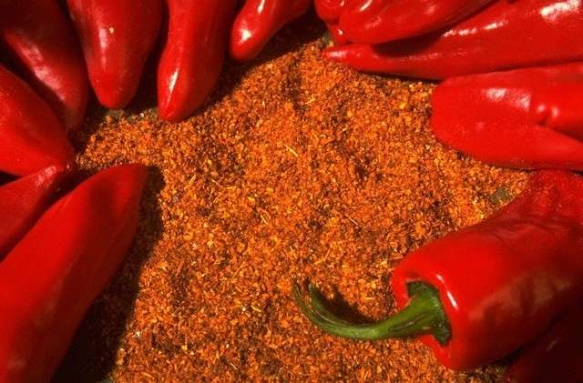

# Яагаад халуун чинжүү эрэгтэйчүүдэд ашигтай байдаг вэ?

Хоолондоо, халуун улаан чинжүү хэрэглэх нь, эрчүүдэд, эрүүл мэндийн гайхалтай ашиг тустай гэнэ. Мексик эрчүүд, ямар ч хоолыг, их хэмжээний халуун чинжүү нэмэхгүйгээр хэрэглэхийг бүр төсөөөлдөг ч үгүй гэх бөгөөд оюун ухааныг цэвэрлэдэг гэж бүрэн итгэн хэрэглэдэг байна. Латин америк, мексик эрчүүдийг, “халуухан” эрчүүд гэж үздэгийг, үүнтэй холбон үздэг.

Хэрэв буйл тань үрэвсээд асуудалтай байгаа бол улаан чинжүүний орцтой шүдний оо хэрэглэх, үс унах асуудлыг мөн улаан чинжүүний найрлагатай шампунь хэрэглэснээр шийдэж болдог. Улаан чинжүү нь, С, Р амин дэмүүдээр баялаг тул судасны ханыг бэхжүүлэхээс гадна, 45-с дээш насныханд “чили” чинжүүг, хоол хүнсэндээ түлхүү хэрэглэх, цус шингэрүүлэх элдэв эмийн оронд, чинжүү хэрэглэхийг сүүлийн үед, эмч мэргэжилтнүүд бичиж зөвлөсөөр байгаа юм. Энэ хэрэглээ, зүрх судасны өвчнөөс сэргийлэх сайхан боломж олгодог байна. Мөн олон ашигтай сахар, амин дэм, тос, каротинууд, капсаицин-алкалоидаар баялаг тул организмд хорт хавдар үүсэхээс сэргийлдэг. “Камасутр”-н эх орон Энэтхэгт, улаан чинжүүг хүсэл тачаалын өдөөгч хэмээн дээдэлдэг гэнэ. Австралийн Тасманийн их сургуулийн судлаачид улаан чинжүүний хандыг хэрэглэх нь нойргүйдлийг эмчилдэг гэж тогтоов. Хэрэв нойрны асуудалтай байгаа бол, яаран нойрны эм тан хэрэглэхийн оронд халуун, улаан чинжүү хоолондоо хэрэглээрэй.
