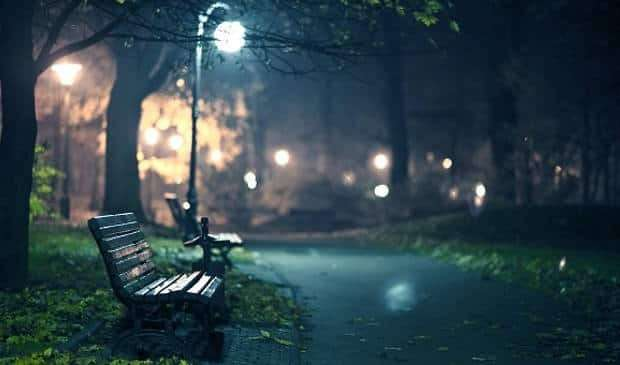

# Яагаад орой үдэш хог гаргаж болдоггүй вэ?

Эртнээс уламжлагдан ирсэн эртний, бид мухар сүсэг хэмээн нэрлэдэг ёс, заншил, тэмдэгүүд амьдралд маань ямархуу үүрэг гүйцэтгэдэг талаар бодож үзсэн үү? Анх, хүүхэд байхаас, ахмад хүмүүс, өвөө эмээ нар тэгж болохгүй, ингэж болохгүй гэж сурган, тэр нь аажмаар дадал болж, дотроо мухар сүсэг гэж үздэг ч мөрдсөөр явдаг. Мөн хориглосон зүйлсээс гажиж, муу үр дагаваргүй болохыг нь нотлохыг нууцхан хүсэвч, дараа нь харамсахвий гэдгээс болгоомжилж, мөн сая сая хүн итгээд мөрдөөд байдаг зүйл учираас анхаарч мөрдөхөөс өөр аргагүй гэж үзсээр иржээ.

. Эдгээр ёс заншил нь, хувь заяа, түүний урьдчилан ирэх тэмдэгүүдийг тайлж чаддаг, байгаль дэлхийтэйгээ илүү ойр байсан өвөг дээдсийн маань туршлага, амьдралаас үүдэлтэй, мөн зохих утга учир агуулдаг гэж үздэг. Эдгээрээс, олон улс орон, ард түмний дунд нийтлэг тархсан, хогийг орой үдэш гаргаж болохгүй гэсэн нэгэн ёсыг тайлбарлах гээд үзэцгээе. Зарим ард түмэн, хог орой гаргахад гэр бүлийн аз жаргалаа гаргана гэж цээрлэдэг. Мөн, зарим нь, эрт дээр үеэс гэр орны ажил төрлөө эрт дуусгаж, оройдоо гэр бүлээрээ тав тухтай амрах ёстой байдаг гэдэгтэй холбон тайлбарладаг бол илүү далд ертөнцийн утгыг агуулсан, шөнө бүр орон гэр, гэр бүлийг хамгаалахаар бурхад бууж ирдэг, тэд, ариун сайхан орчинг сонгон саатдаг тул, эрт гэр орноо цэвэрлэж, хогоо эрт гаргасан байх ёстой байдаг гэсэн, өөр нэгэн тайлбар байдаг. Ямартай ч эдгээр тайлбарууд бүгд, гэр орноо эрт цэвэрлэж, хог хаягдалаа хонуулахгүй үдшээс өмнө гаргах хэрэгтэйг сануулдаг бөгөөд энэ нь, гэр орны ая тух, эв эеийг хадгалахад нөлөөлдөг гэж үзсээр иржээ. Эдгээр ёс, заншил, тэмдэгүүдэд итгэх эсэх нь таны дурын хэрэг боловч, олноороо зуун зуун дамжин мөрдсөөр ирсэнийг мөн анхаарахгүй орхиж болмооргүй юм. Мөн, ёс заншил, элдэв тэмдэгүүдийг мухар сүсэгт тооцон, үгүйсгэсэн нотолгоог эрж хайвал, ертөнцийн үүслийг тайлж чадахгүйн адил мухардалд хүрдэг. Ер нь мухар сүсэг далд ухамсарын түвшинд ажилладаг гэж үздэг. Тиймээс, ямарваа нэг үр дагавраас зайлсхийх, сэтгэл сэвгүй байхын үүднээс хогоо орой гаргаж хаяхгүй байх нь зүйтэй биз ээ.
