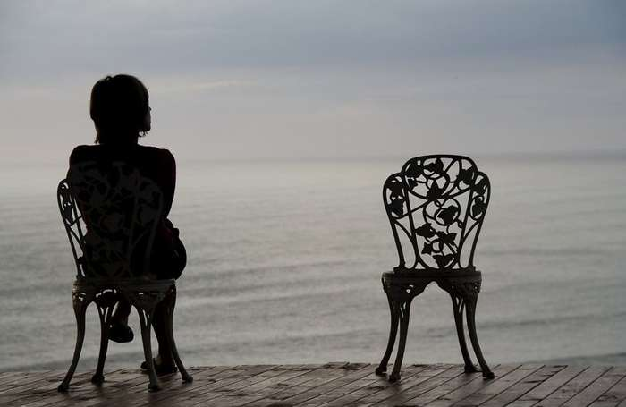

# Яагаад зарим хүмүүс, насаараа ганц бие явдагийн алдааг харуулах, сургамжит түүх

Нэг эмэгтэй, ганц бие, нөхөрт гарах хүслэн болсон найзынхаа талаар ийнхүү ярьсан бөгөөд энэхүү найз эмэгтэй шиг нь хүмүүс, та бидний эргэн тойронд амьдарч байдгийг мэдэхгүй хүн үгүй биз ээ. Энэ түүхийг уншаад, тэдгээр хүмүүсийн асуудлыг өөрөөр харж эхлэн, магадгүй өөртөө ч зарим зүйлийг өөрчилөх хүсэл төрөх нь дамжиггүй юм.

Энэ эмэгтэй ийнхүү хүүрнэв. Манай найз, бараг 10-д жил ганц бие, хань нөхөртэй болохыг хүсч эрэлхийлж яваа, 30 гаран насны, байдал төрх, ухаан бодлоороо бусдаас их ялгарах зүйлгүй нэгэн. Төрийн байгууллагад ажилладаг, цалин нь ч их өндөргүй, оройд ажлаас ирж цэнхэр дэлгэц ширтэн өнгөрүүлдэг. Цаг хугацаа өнгөрч байна, тэр маань ч, юу нь сайжирах билээ. Уулзах бүртээ, гэр бүлтэй болохсон, ганц бие амьдралаас залхлаа гэсэн зүйл ярьж гомдоллон, хүнтэй танилцуулж өгөөч гэж намайг байнга гуйна. Би ч тусламаар санагддаг л даа. Манай нөхөр, авто засварын газар ажилладаг болохоор, би, нэг удаа, нөхрөөсөө, ажил дээр нь ганц бие сайн хүн байдаг болов уу гэсэн чинь, -“Нэг архи дарс уудаггүй, аятайхан, ганц бие залуу байдаг” гэснээр, найзыгаа танилцуулах уулзалт зохион байгуулахаар болж, түүнийгээ найздаа хэлтэл бөөн баяр болсон хүн гүйж ирэв. Тэгээд л, юу хийдэг вэ гэж асууж байна. Би, засварчин, аятайхан сайн хүн гэсэн гэж хариултал, найз маань, -“Би, засварчинаар яах юм. Надад, захирал ч юм уу, ухаантай, боловсролтой, өгөөмөр, гоё залуу л хэрэгтэй байна” гэхэд нь, би бүр хэлэх ч үг олдсонгүй, дотроо, ухаантай, өгөөмөр, захирал гоё залууд, боловсролгүй, бэлгүй, гоо үзэсгэлэн, гоё сайхнаараа гавихгүй чам шиг хүн юу гэж хэрэгтэй байх вэ дээ, гэж бодсоноо эгээтэй л хэлчихсэнгүй дуугүй өнгөрүүлж, тэр ч удалгүй явав. Нөхөр бид хоёр, болзоог нь товлосон өдөр дөхөж, нөгөө залуугаас санаа зовж юу гэж хэлэхээ мэдэхгүй байцгааснаа, өөр нэг найз эмэгтэйгээ, найзынхаа оронд танилцуулах арга олцгоов. Тэр, мөн 30-д насны, ердийн л нэг бүсгүй. Эхний болзоо болж өнгөрөн, болзооныхоо дараа, найз маань надад, утсаар –“Аятайхан сайн залуу байна. Дахин уулзахаа тэсэж ядан хүлээж байна” гэсэн баяртай мэдээ дуулгав. Тэгээд, би нөгөө залууд утасдаад, болзоо ямархуу өнгөрснийг асуув. Тэгтэл, өнөөх залуу, -“Зүгээр л бүсгүй юм. Гэхдээ миний бодсон хүн биш юм. Надад, өндөр, гоё биетэй, үнэтэй сайхан хувцасладагэмэгтэй таалагддаг” гэдэг байгаа.\
Энэ тохиолдлоос хойш би, дээрх гурван хүн, гурвуулаа аз жаргалтай гэр бүлийн амьдралаар амьдрах бодит боломжуудаа, байхгүй төгс зүйлийг хөөцөлдөн алдаж байдаг гэдгийг анзаарсан. Дараа нь, тэд манайд ганц нэгээрээ зочилж ирэхдээ, ханьтай болохсон, нөхөр бид хоёрыг хамтдаа сайхан амьдрах юм аа, гэсэн зүйлс ярьцгаадаг юм. Миний нөхөр, захирал биш, захирал болтлоо ч өдий, би ч загвар өмсөгч биш, гэхдээ бид хамтдаа босгосон, бүрэн бүтэн гэр бүлийн амьдарлаар амьдардагдаа сэтгэл хангалуун байдаг шүү, гээд жаргал дүүрэн инээмсэглэж суусан юм. \
Үүнийг сонсох үед, аливаа нөхцөл байдлыг илүү бодитоор үнэлж дүгнэн, бусдад тавих шаардлага, шалгуураа өөрөөсөө эрж хайх хэрэгтэй, мөн орчиноосоо нэхэх, хүсэх зүйлдээ өөрөө таарах, тохирох эсэхээ бодож байх нь зүйтэй юм гэсэн бодол төрж суулаа. Та юу гэж бодож байна? Хуваалцаарай!
