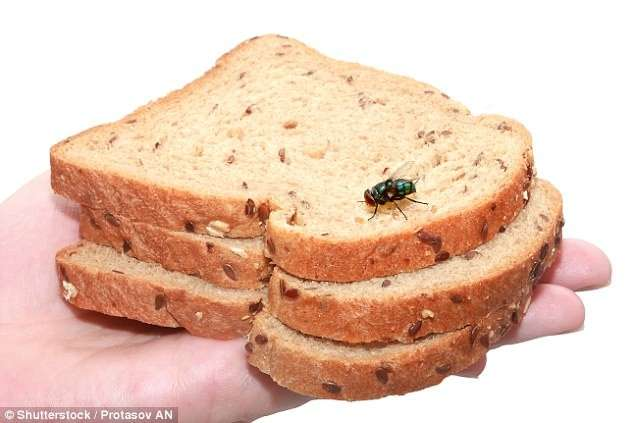
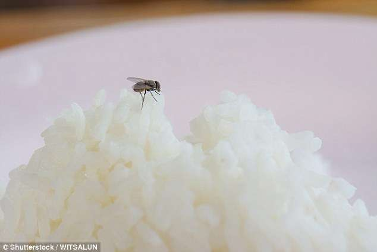

# Ялаа суусан хоол хүнс ямар болдог вэ

Дулааны улирал болж, ялаанууд амилан зуслан, гэр оронд олширч түвэг учруулж байдаг бөгөөд хоол хүнсэн дээр энэ амьтан суух нь ямар аюул дагуулж байдгийг тэр бүр хүмүүс мэддэггүй. Ялааны хөлөөр тоо томшгүй нян бактери дамждаг бөгөөд эдгээр амьтан ялзарч муудсан, эсвэл маш чихэрлэг зүйлст дуртай байдгаас асар богино хугацаанд нян бактерийг тухайн зүйлсээс цуглуулж амждаг ба 200 гаруй төрлийн хүний биед хортой нянг тарааж байдаг гэнэ. Хөлний хэсэгт нь байрлах зуу зуун жижиг үсэрхэг гадаргуу нь, хормын төдийд нянг тараадаг ба эдгээр олон төрлийн нянгийн олонхийг бидний бие организм эсэргүүцэх чадвартай байдаг хэдий ч, халдварт өвчин авах эрсдэлд өртөх магадлалаа өсгөж байдаг. Тиймээс хоол хүнсэн дээрээ ялаа суух боломж олгохгүй байх, ил задгай орхихгүй байхыг эрүүл мэндээ хамгаалдаг ухамсарт хүн бүр мөрдөх ёстой гэж Английн хортон шавьж судлалын институтээс анхааруулж байна. Мөн, ялаа нь суусан газар бүртээ ялгадсаа үлдээдэг, идэж байгаа бүх зүйл дээрээ өөрсдийн хоол боловсруулах шингэнээ ялгаруулдаг гэнэ. Бодохоос аймаар.
