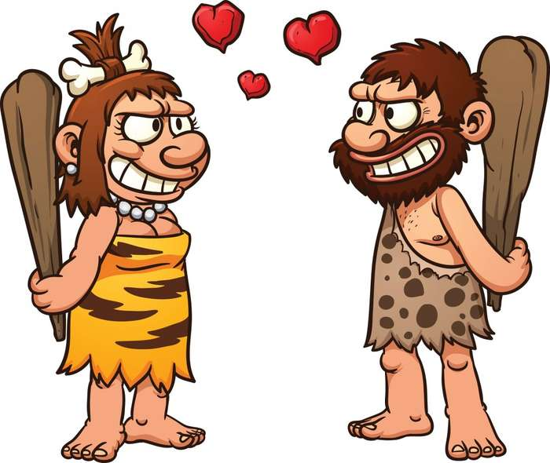

# Ямар эхнэртэй суух нь дээр вэ? буюу урт удаан хамтын амьдралын нууц

Ихэнхи ганц бие эрчүүд, “эхнэр”-ийн тухайд, гуалиг биетэй, том хөхтэй, торон дотоожтой, долоогоос дээш насаар залуу байвал гэрлэж болох юм, гэх маягийн бодол тээж явах нь их байдаг гэнэ. Гэхдээ, энэ нь тэдний түр зуурын учиралтай нь холбоотой, мөн торон дотоож өмсөхөө болих үеийг тооцож бодож хүлээн авдаггүйтэй нь холбоотой байдаг байна. Харин ухаалаг, мөн туршлагатай эрчүүд ямар эмэгтэйтэй суувал дээр болохыг, мөн дараа нь харамсахгүйгээр урт удаан амьдарч болохыг дараах маягаар илэрхийлцгээдэг гэнэ. Эрэгтэй хүний нийтлэг эхний алдаа бол, гоо үзэсгэлэнтэй, анхаарал татсан “хатан хаан” мэт дүр төрхийг хүсэмжилж явдаг төөрөгдөл нь юм. Торон дотоож цагийн эрхээр өмсөгдөхөө больж, түүнийг нь анзаарахаа ч больдог. Сонирхолтой нь, хүн ямар ч гадна төрхөнд 5-7 жилийн хугацаанд дасч орхидог. Дэргэдэх нь, бараг ямар ч байсан анзаарахаа больдог гэсэн үг бөгөөд сайхан, гоё сайхныг эрэлхийлэгч эр хүн маань, өсвөр насны оюун ухаанаасаа нэг мөсөн салж буйн илрэл нь болдог гэнэ. Харин урт удаан хамтын амьдрал нь, сексийн харилцааны зохицол, ахуй байдлыг ижил хүлээн авах мэдрэмж, мөнгөнд хандах хандлага ижил төстэй байх гэсэн, үндсэн 3 зүйл дээр таарамж байгаа эсэх дээр тогтдог. Мөнгөнд хандах хандлагын хувьд, ижил төстэй байхыг хамгийн гол зүйл гэж үздэг. Нэг нь үрэлгэн, нөгөөх нь нарийн байх нь хамтын амьдралын гол дайсан гэдэг. Мөн үүнээс илүү чухал таарамж шаарддаг, хамтын амьдралыг устгах хөнөөлтэй зүйл бол, ахуй байдалдаа хандах таарамжгүй, ижил бус хандлага юм. Нэг нь цэвэрч нямбай, нөгөөх нь цалгар, салан задгай бохир байдаг тохиолдолд, эсвэл хоёулаа замбараагүй байх асуудалтай холбоотой амьдрал нь утгаа алддаг. Та өөрөө, ямар хандлагатай байна, түүндээ таарсан, ижил төстэй зан чанартай хүн сонгохыг эрхэмлэх нь, аз жаргалтай амьдрахад хүргэж байдаг гэжээ.

