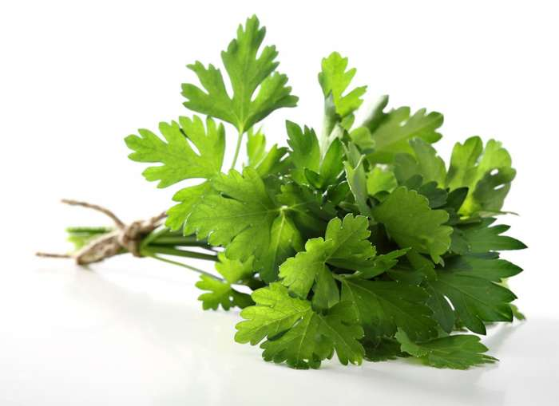

# Яншуй, нүдний хараа болон нүдний олон өвчилөлд тустай хүчтэй ногоо

Яншуйг эртнээс, эмийн ургамал маягаар, мөн хүнсний хэрэглээнд өргөнөөр ашиглаж ирсэн бөгөөд А, К, С, Е, В16, В12 аминдэмүүд, кальци, магни, марганец, кали, цинк гэсэн олон ашигт элементүүдээр баялаг тэжээллэг ургамал юм. Хүний дархлааг өсгөх, хавдар үүсэхээс сэргийлэх, эд эсийн ислэг орчинг бууруулах, зүрхний үйл ажиллагааг дэмжих, яс бэхжүүлэх, хаван, шээс хөөх үйлчилэлтэйгээс гадна, бөөрний чулуу, цөсний чулуу хөөх, бие организмын үрэвслүүд дарах, шүдний өвчин дарах, артритад тустай байдаг. Мөн нүдний гадна бүрхэвчийг хамгаалах, чийгшилийг хадгалах, насжилтаас шалтгаалсан харааны өөрчилөлт, хараа муудахаас сэргийлэх, катаракт, коньюнктивит, чихрийн шижин хараанд нөлөөлөх, глауком, нүдний торлогтой холбоотой харааны гажилт, нүдний мэдрэлтэй холбоотой асуудлууд, ретинит зэрэг нүдний өвчлөлүүдэд, шүүсийг нь шахаж уух үр дүнтэй байдаг.

Үүнд:\
Хараа муудахад, яншуйг, дараах цоохор майлз, сармис, хүрэн манжин, цагаан гаа, алим, лууван, нимбэг, бөөрөлзгөнө, байцаа, усан үзэм зэргээс аль нэг 3-ыг нь сонгон хольж шүүсийг нь шахаж ууж хэрэглэх\
Катаракт, коньюнктивит-Яншуй, нэрс, алим, бууцай, цоохор майлзны холимог шүүс\
Ретинит-яншуй, бууцай, цагаан гаа, лууван, сонгоино, сармис\
Глаукома-яншуй, лууван, өргөст хэмх, цоохор майлз, манжин, хүрэн манжин, алим, чавга. /3-г нь сонгох/\
Торлогийн гажилт-яншуй,цоохор майлз, хүрэн манжин, алим, лууван, байцаа, цагаан гаа, сонгино, нимбэг. Эдгээрээс 3-ыг сонгон шүүс хийж уух\
Нүдний мэдрэл-яншуй, хүрэн манжин, цагаан гаа, лууван, байцаа
