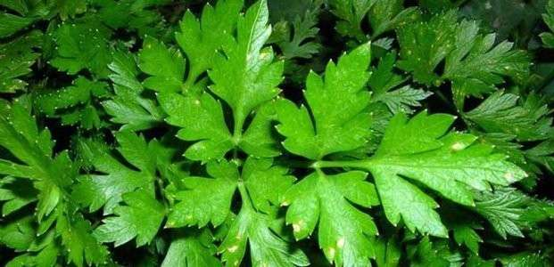
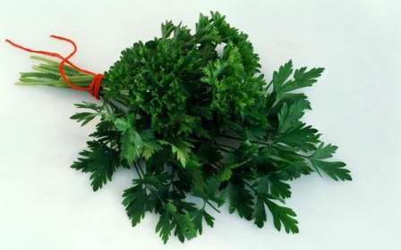

# Яншуйны ашиг тус

Амтлагч ногоонуудаас, бидний хамгийн их танил яншуйны ашиг тусыг та бүхэнтэйгээ хуваалцъя.

Гайхалтай урт жагсаалт болж байгаа биз? Яншуйны навч болон үндсэнд ашигт эрдэсүүд болох төмөр, калий мөн кальци их хэмжээгээр байдаг бөгөөд С амин дэм /100грамд, хүний өдөрт шаардлагатай С амин дэмийн нормоос 2 дахин их/байдаг ба мөн Е,РР, В1, В2 амин дэмүүдээр баялаг юм. Яншуйны ашигт чанар буцалсан усны үйлчлэлд ч хадгалагдаж байдаг тул ханд маягаар хэрэглэхэд ч ашиг тустай байдаг. Мөн удаан хадгалж хэрэглэхийн тулд, давсалж, хатааж хэрэглэсэн ч болдог. Яншуй нүдний хараанд сайн\
Яншуй зүрх судасны үйл ажиллагааг сайжруулдаг \
Яншуй бөөрний өвчин, давсагны халдварыг эмчилнэ\
Яншуй хүчтэй флавоноид антиоксидант, эфирийн тосны агууламжтай тул ходоодны шүүрлийн ажиллагааг тогтворжуулдаг. \
Яншуй хорт хавдарыг зогсоох, шинж чанартай\
Яншуй стрессийг дардаг\
Яншуй амьсгалыг сэргээх үйлчилгээтэй. Үүний тулд хэсэг навч авч зажилдаг. \
Яншуй үрэвслийн эсрэг хүчтэй зэвсэг\
Яншуйн ханд биед шингэн хуралдахаас сэргийлдэг \
Яншуй цус цэвэрлэх үйлчлэлтэй\
Яншуй шээс хөөх үйлчлэлтэй бөгөөд биедэх илүүдэл шингэнийг гадагшлуулдаг\
Яншуй шээсний хүчиллэг чанарыг бууруулдаг\
Дангаар нь хэрэглэхэд ходоод цочроох хүчтэй үйлчилгээтэй тул, хоол хүнсэндээ болон өөр бусад ногоотой хамт хэрэглэх нь зүйтэй. Мөн эмэгтэй хүний саванд хүчтэй нөлөөлдөг гэдэг, энэ нь хоёр талтай ба ердийн үед байх ёстой чанарыг тэтгэдэг, харин жирэмсэн үед хэрэглээгээ багасгахыг зөвлөдөг. Бөөрний хурц үрэвсэлийн үед хэрэглэж болохгүй.

Гарын дор хаанаас ч авах боломжтой энэхүү амтлагч ногоог хоол бэлтгэхдээ, түлхүү хэрэглэхийг зөвлөе.
