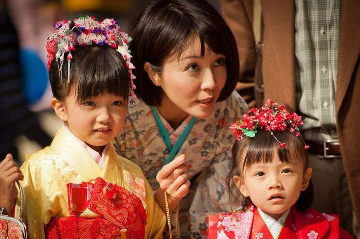
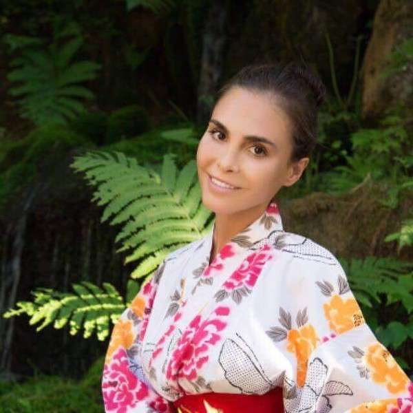

# Япон ээж нараас суралцах зүйлс

Эмэгтэйчүүдийн эрүүл мэнд, гоо сайхны нэртэй блогчин, бизнесмен Юлия Энхель Япон оронтой ажил үйлсээ холбосон, ажил төрлөөр байнга ирж, очин амьдардаг салшгүй холбоотой нэгэн аж. Тэр, япончуудын ажилсаг чанар, бүтээлч сэтгэлгээ, мөн хүүхдүүдээ хүмүүжүүлэх арга барилыг харж бахархаж явдаг талаараа Wday.ru сайтад ярилцлага өгчээ. Тэрээр, япон орон бол дэвшилтэт нээлтүүдийн орон, түүнчилэн сайн, хүмүүжилтэй хүүхдүүдээр ирээдүйгээ бүтээж байдаг хүмүүс хэмээн магтаад, -би хэзээ ч амттан эсвэл тоглоом нэхэж орилж, уйлсан хүүхдүүдийг тэнд хараагүй. Мөн үүнээс болж уурлаж цухалдан загинах эх эцгүүд огт байдаггүй нь сонин. Харилцан хүндэтгэл, халуун дулаан харилцаан дээр бүх зүйл нь тогтдог. Хорьж цагдахыг хүүхдийг стресст оруулна гэж үздэг. Халуун устай аяга байлаа гэхэд бид, хүүхдээ түлэгдчихнэ гэж төрөл бүрээр ойртуулахгүй байхыг хичээнэ. Харин тэд, үүнд тайван хандаж, гар хуруугаа түлчихвэл, уг үйлдэл нь өвдөлт өгч, халуун зүйл мөн хүйтэн зүйлийн ялгааг өөрөөр нь ойлгуулахад анхаардаг. Япон эмэгтэйчүүд, хүүхэдтэй болмогцоо аль болох хүүхэдтэйгээ удаан хамт байхыг эрхэмлэж, эх хүн болсноо, эх хүн байхыг бүхнээс дээгүүр тавьдаг. Эмээ өвөөгөөр, асрагчаар харуулах асуудал гэж байдаггүй, эх хүний үүргээ өөрөө үүрдэг. 5-15 насыг, япон хүүхдүүдийн хувьд, дүрэм журам мөрдөх, нийгмийн сонирхол бүх зүйлээс дээгүүр зүйл гэдгийг ойлгуулах, хүн бол энэхүү системийн жижигхэн хэсэг гэдгийг ухааруулах, мөн дүрэм журмыг дагахгүй ялгарвал нийгмээс тусгаарлагдан гадуурхагдах боломжтой гэдгийг ухамсарлуулах үе гэж үздэг. Нийгэмд ялгагдан гадуурхагдах гэсэн ойлголт нь япончуудын хамгийн айдаг хар дарсан зүүд. Японы цэцэрлэг, сургуульд хэзээ ч, хүүхдүүдийг нэгнийг нь нөгөөхтэй нь харьцуулах ойлголт байхгүй. Учиргүй тэмцэж өрсөлдөх асуудлыг, бүр спортын уралдаан тэмцээнд ч хүүхдүүдийн дунд тавьдаггүй. Зөвхөн багийн хэмжээнд авч үздэг. 15 настайдаа япон хүүхдүүдийг, хувь хүний хувьд төлөвшсөн гэж авч үздэгээс томчуулын хэмжээнд харьцаж эхлэнэ. Япон эцэг эхчүүд, хүүхдээ хүмүүжүүлэхдээ хамгийн гол нь зохист харьцаанд байх хүн өсгөж хүмүүжүүлэхэд анхаарч, дэлхийн хамгийн өндөр технологийн орон гэж нэрлэгдсэн улсынхаа сахилга баттай, хууль журмаа сахидаг иргэн болгон хүмүүжүүлэх үүргээ гүн гүнзгий ойлгосон байдаг нь гайхалтай гэсэн ярилцлага өгсөн байна.

