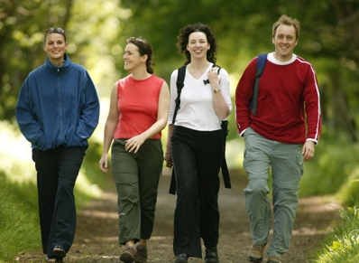

# Явган алхах нь, тархины үйл ажиллагааг гайхалтай сайжруулдаг

Явган алхах нь эрүүл мэндэд тустайгаас гадна, тархины үйл ажиллагааг гайхалтай сайжруулдаг гэнэ.

Алхаж явах үед, шинэ соргог, сонирхолтой санаа, зөв шийдвэрүүд гарч ирдэг нь бидэнд танил боловч, үүнийг бид алхахтай холбож үздэггүй, анзаардаггүйгээс мэддэггүй байна. Стэнфордын их сургуулийн эрдэмтэд, явган алхах нь, хүний сэтгэлгээний хурд, бүтээмжийг өсгөдөг болохыг, нэг нь алхдаг, нөгөөх нь тээврийн хэрэгслээр явдаг хоёр хүний бүтээлч сэтгэлгээний түвшинг харьцуулан үзсэнээр тодорхойлсон бөгөөд алхах, явган явахад сэтгэлгээний хурд, бүтээмж, дундачаар 60% нэмэгддэгийг нотолжээ. Стив Джобсын зугаалангаа уулздаг, “зугаалгатай уулзалт”-ыг бүгд мэддэг, мөн Марк Цукерберг уулзалт ярилцлагын үедээ, үргэлж зогсч, холхиж байдаг зэргийг Стэнфордын их сургуулийн судлаачид, шинжлэх ухааны үүднээс тайлбарлахыг зорьсны үндсэн дээр 176 хүнийг хамруулсан судалгаа хийсэн байна. Энэ үед, алхаж явах үед өссөн сэтгэлгээний түвшин, мөн хэсэг хугацааны турш хадгалагдаж байдгийг илрүүлсэн бөгөөд энэхүү мэдээ маань, таны алхах, явган зугаалга хийх хүслийг тань өдөөсөн гэж найдахын ялдамд, үдийн цайны цагаараа богино зайнд алхаж агаар амьсгалах, ажилдаа хоёр гурван буудлын зайнаас алхаж ирж, очих бололцоо гаргах, цаг тутам ширээнээсээ босч офис дотроо алхах зэрэг наад захын алхамуудаас эхлэн, оюун сэтгэлгээгээ сайжруулах сайхан аргыг ашиглахыг зөвлөе.
