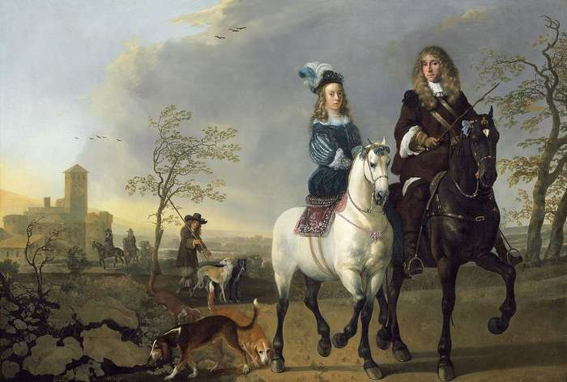
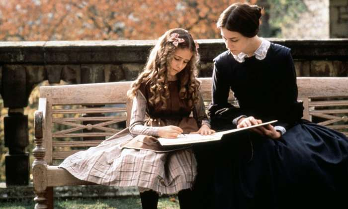

# Язгууртануудын, хүүхэд хүмүүжүүлдэг байсан аргууд ба авууштай талууд

Өнгөрсөн үеийн язгууртнууд, багаас нь сургаж хүмүүжүүлсэн хувийн зан чанарын онцлогоороо ялгардаг байсан нь ном зохиол, кино, жүжигээс харагддаг. Язгууртны хүмүүжил нь, шударга журамтай, зоригтой, арчаатай нямбай, сайн хүмүүжилтэй хүнийг төлөвшүүлэхэд чиглэдэг, маш үр дүнтэй арга байсан бөгөөд хүүхдүүдэд, одоо ч хэрэгжүүлмээр, гайхалтай сайхан хувь хүний зан чанарыг суулгаж өгөх чадвартай хүмүүжлийн арга гэдэгтэй, дараах зүйлийг уншаад санал нийлнэ гэдэгт үл эргэлзнэм.

#### Нэр төрөө эрхэмлэх ёс

Бага байхаас нь, шударга байдал, эр зоригтой байх, боловсролтой байх, биеэ зөв авч явах, харьцааны соёлтой байх зэрэг бүх харилцаанд өндөр шаардлагууд тавьж, “нэр төр”, “хэлсэн амандаа хүрэх” зэрэг эрхэм ёс, зарчимуудыг цусанд нь шингэтэл зааж сургадаг байжээ.

#### Эр зоригийн хүмүүжил

Хулчгар занг язгууртан хүнд байж болшгүй зан чанар гэж ойлгуулан зориудаар, сэтгэлийн дур зоргоор гарах хүчийг дасгалжуулах замаар, юунаас ч айхгүй аюулын өмнөөс зоригтой тулж давах, ялах чадварыг эрэгтэй эмэгтэй гэж ялгахгүй өгч сурган, хүмүүжүүлдэг байжээ.

#### Бие мах бодын хүчтэй, гавшгай чанар

Ихэвчлэн эрүүл агаарт, зайлшгүй чаддаг байх дараах чадваруудыг эзэмшүүлдэг байв. Морь унах, туялзуур сэлэм эзэмших, усанд сэлэх, сэлүүрт завиар явах үүнд багтдаг байсан ба хүч чадал, гавшгай байдал, тэсвэр тэвчээр шаардсан ан агнах чадварыг заавал эзэмших шаардлага тавьдаг байжээ.

#### Биеэ барих чадвар

Жинхэнэ язгууртан хүн ямар ч тохиолдолд тайван, сандарч мэгдсэн байдал гаргадаггүй байх ёстой гэсэн шаардлага тавьж, хувь заяаны ямар ч цохилтыг эрэлхэгээр, нэр төртэй хүлээж авах, давахыг хүүхэд байхаас нь сургадаг байв. Сэтгэлийн хөдлөлдөө дийлдэх, биеэ барьж чадахгүй байхыг хамгийн ичгүүртэй зүйлд тооцдог байжээ.

#### Гадаад төрх

Дутагдалтай талаа дарж чаддаг, сайхан харагдахыг эрхэмлэхийг сургаж, цэвэрхэн дүр төрхтэй байхын чухлыг ойлгуулж, эрэгтэй эмэгтэйгүй, хумс, үсэндээ анхаарах ёстойг заадаг байв.

#### Таалагдах чадвар

Харьцааны соёлд их анхаарч, ямар ч хүрээлэлд, долигонох тал засахгүйгээр нэр төртэйгээр, хэнтэй ч хүндэтгэлтэй хандаж харьцах, яриа хөөрөө өрнүүлэх чадвартай, бусдыг тэвчээртэй сонсдог, дур татам биеэ авч явах чадвартай болоход сургадаг байжээ.

#### Даруу зан

Даруу занг, ичимхий бүрэг, биеэ барьсан байдал биш харин өөртөө тавих харьцааны хязгаарлагдмал чанар гэж үздэг байсан бөгөөд бусдын ярианд хөндлөнгөөс оролцох, яриа таслах, ярианы сэдвийг өөрчлөх, хэт чалчих зэргийг ичгүүрт тооцдог байв

#### Үг яриа

Хэл ярианы, зайлшгүй мөрдөх 2 дүрэм үйлчилдэг байсан ба эхнийх нь: хоорондоо доромж үг хэлэлцэж болох ч хамгийн эелдэг хэлбэрээр илэрхийлэх шаардлага тавьдаг байсан бөгөөд энэ нь хэл яриа эзэмших урлаг, хурц ухааныг шаарддаг тул, үг ярианы цэвэр байдлыг эрхэмлэхэд сургадаг байв. Хоёрдох дүрэм: эх хэлээ гарамгай мэдэх шаардлага ба гадаад хэлний мэдлэг нэгээр тогтохгүй байх ёстой гэж шаарддаг байжээ.\
Эдгээр зарчимууд үеэс үед дамжин, бүрэн утгаар хэрэгждэг байсныг түүх нотолдог билээ.
