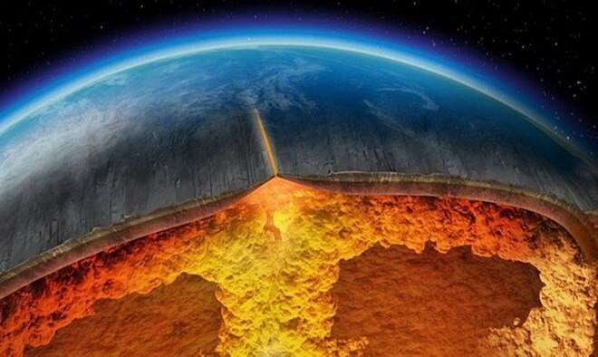

# Yellowstone-н галт уул сэргэж түгшүүр төрүүлж байна

Дэлхийн сейсмологичдын анхаарлын төвд байсаар ирсэн, айдас түгшүүрийг төрүүлэн байдаг, Америкийн Баруун хойд хэсэгт орших, Йеллостоуны галт уул сэргэжээ. Энэ аймшигт галт уулын дэлбэрэлтийн хүч, америкийн газар нутгийн хагасыг сөнөөх аюултай гэж үздэг. Судлаачид, Айдахогийн газар хөдлөлт, уг галт уулын идэвхижлээс болсон гэж үзэж байгаа бөгөөд уг галт уул, уур утаагаа их хэмжээгээр өндөрт хаядаг болсон нь, мөн гейзерүүдийнх нь ер бусын өөрчилөлтүүд, зарим хэсэг газрууд нь товойн өндөрсөх, мөн гол горхи буцлах, бизонууд дайжих зэрэг тайлбарлашгүй үзэгдлүүд болж байгаатай холбон, дэлбэрэх процесс эхэлсэн гэж гэж үзэх үндэслэлтэй гэж нотолж байна. Өнгөрсөн 9 сард, Калифорни мужид орших Лонг Велли галт уулын тогоонд, өндөр хэмжээний идэвхижил ажиглагдсанаас гадна, бэл хэсгээр хөдлөх газар хөдлөлтүүд, урд нь жилд 10-д удаа ажиглагддаг байсан бол, одоо сүүлийн нэг сард 3,3 баллын хүчтэй газар хөдлөлт 1104 удаа бүртгэгдсэн нь судлаачидын түгшүүрийг төрүүлж байгаа аж. Мөн, Лонг Велли /*Long Valley*/, Йеллостоуны /*Yellowstone*/ галт уулууд хоорондоо нягт холбоотой, нэг уулан дах аль нэг гейзерийн өөрчилөлт нөгөө уулын гейзерүүдэд нөлөөлдөг болохыг тогтоосон байна. Сейсмологийн эрдэмтэн судлаачидын олонхи нь, хэрэв Йеллостоун галт уул дэлбэрвэл, зөвхөн америкийн газар нутгийн нэг хэсгийг устгаад зогсохгүй, дэлхийн хэмжээний сүйрэлд хүргэх аюултай гэж үзэж байна.

<iframe src="https://www.youtube.com/embed/h8ks-g2LkJQ" width="640" height="360" allowfullscreen></iframe>
