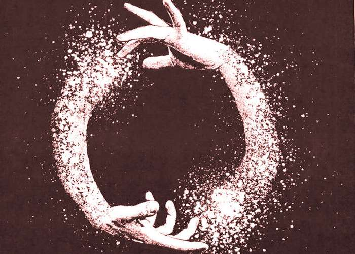

# Үйлийн үр ба карма

Таныг өвтгөсөн, танаас урвасан хэн ч болов, хэзээд өөр дээрээ түүнийгээ үзнэ. Шувууд амьдарч байхдаа шоргоолж шавьжаар хооллох ч, үхэж үрэгдсэн үед нь шоргоолж шавьж түүгээр хооллодог. Тиймээс, нөхцөл байдал, оршихуй нь, үргэлжид яаж ч өөрчилөгдөж болох зүйл. Амьдралд таарах, өөрөөсөө сул дорой хэнийг ч тэр, хэзээ ч бүү гадуурхаж дорд үз. Өнөөдөр та, хүчирхэг байж болох ч, цаг хугацаа юунаас ч илүү хүчтэй, тэр дундаа танаас бүр их хүчтэй гэдгийг санаж яв. Хүмүүсийн алдааг өршөөж уучилж, мөн үзэн ядалтыг үүсгэх ятгалгад бүү авт, нөхцөл байдлыг өөрт таатай байлгахаар бүү тулга, ийм тохиолдолд карма хэмээх “Үйл”-нь, бүхнийг үрийнх нь дагуу байр байранд нь тавьж байдаг. Кармад тодорхой жор, цэс байдаггүй. Таны авах ёстой зүйлийг л хувь тавилан бэлэглэдэг. Тантай хүмүүс яаж харьцаж байна, энэ нь тэдний карма. Харин та, тэдэнд яаж хариулж байна тэр нь, таны карма. Карма хэзээ ч хаяг андуурдаггүй. Мөн, кармаг ийм маягаар цэвэрлэж болдог аж:

-Байгаа бүхнээ үнэлж, талархаж бай

-Ихээр, урт удаанаар, гүн бат хайрлах, энэрэх сэтгэлтэй бай

-Өөрөөсөө, би яагаад ингэж хийв, өөрөөр байж болоогүй юу гэж байнга асууж бай

-Өршөөж, уучилж бай. Гомдол ямар ч ашиггүй зүйл.

-Сайн сайханд хүрэхийн тулд, саад бэрхшээлийг туулан гардаг. Аз жаргал ийм замаар олддог.

-Сайн зүйл хийж бай. Юу хийнэ, тэр зүйл чинь 10 дахин үржигдэн буцаж ирнэ.

