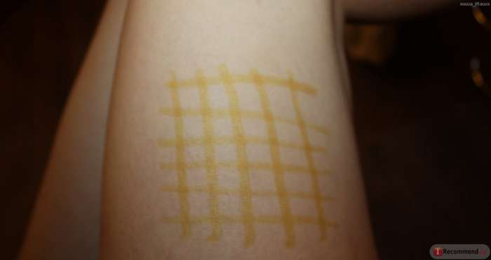

# Йодоор торлож зурах, эмчилгээний арга

Йодоор торлож зурах арга нь, бие дэх йодын дутагдлыг илрүүлэх, ханиад, нусгай, салхинд цохиулсныг эмчлэх, биеийн хөхөрч няцарсныг түргэн эдгээх, жирэмсний үеийн эмчилгээнд тустай.

-торлож зурахдаа, чих цэвэрлэгээний зориулалттай модтой хөвөнг, 5%-н йодонд дүрж, бие дээрээ тор маягаар зурна. Зурах торны нүднүүд, 1см квадрат орчим байх ба йод нь, судасны хана, арьсны эд эсээр нэвчин өвчин үүсгэгч бичил биетүүдийг устгадаг. Торлож зурдагийн учир нь, зарим төрлийн бактеруудыг, йодоор торлон нэвчүүлж хооронд нь салгах, устгах зориулалттай. Арьсаар дамжин ордог бактеруудыг йод илүү устгадаг гэдэг. Дэлхийн хүн амын гурван хувь, йодын дутагдлаас болж бамбай булчирхайн өвчлөлтэй, жирэмсэн эхчүүд дутуу хөгжилтэй ураг тээх эрсдэл дор амьдардаг байна. Йодын дутагдалд орж буй эсэхээ мэдэхийн тулд йодыг бие дээрээ торлон зурахад л хангалттай аж. Үүний тулд, гуяны дотор талд торлон зурах хэрэгтэй ба 3 цагийн дараа, зурсанаас ор мөр үлдэхгүй шингэвэл, яаралтай эмчид хандаж йодын дутагдлаа нөхүүлэх эмчилгээ хийлгэх хэрэгтэй. Хэрэв 6-8 цагийн турш шингэж алга болвол, бага зэргийн дутагдалтай гэж үздэг ба өдөр тутам авдаг йодын орцтой хүнсний хэрэглээндээ анхаарч түлхүү хэрэглэх хэрэгтэй. /далайн байцаа, далайн загас, далайн бүтээгдэхүүнүүд/ Харин эрүүл хүмүүсийн бие дээр зурсан йод хоногийн турш шингэж алга болдог. Ханиад, нусгай ханиадын үед, хөлийн шилбэний булчин, тавхайн дээд хэсэгт торлон зурна. Хөхөрч няцарсан биеийн хэсэгт, тэр дор нь йод зурж болдоггүй. Хоногийн дараа йодоор торлож зурахад тустай. Жирэмсэн эхчүүдэд йодын дутагдлаа нөхөхийн тулд эмчтэй зөвлөн хэрэглэх, ялангуяа ханиад томууны үед жирэмсэн хүн, эм антибиотик уух хэрэглэхийг хориглодог үед йодоор торлож зурах арга нэн тустай байдаг байна
