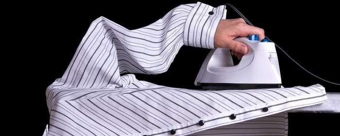
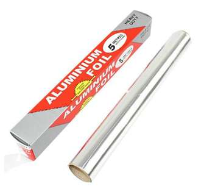

# Юм индүүдэхийг хөнгөвчлөх арга

Юм индүүдэх дуртай хүнийг олоход бэрх.

Тэгвэл энэ түвэгтэй, цаг үрсэн ажлыг, хүнсний тугалган цаасаар, индүүдлэгийн тавцангийнхаа бүрээсэн доогуур дэвсэж өгснөөр шийдэж болох нь. Зориулалтын тавцан хэрэглэдэггүй бол, индүүдлэг хийх гадаргуу дээрээ, тугалган цаасаа дэвсэж, дээр нь даавуу тавиад л болох нь тэр. Тугалган цаас нь, дулааныг сайн хүлээж авдаг тул халж, индүүдэж буй зүйл тань хоёр талаасаа толийно гэсэн үг. Ингэж индүүдэхэд, хугацааг 2-3 дахин хэмнэж, та, үнэт цагаа өөртөө зориулах болно.

---

