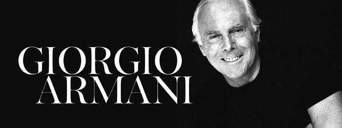
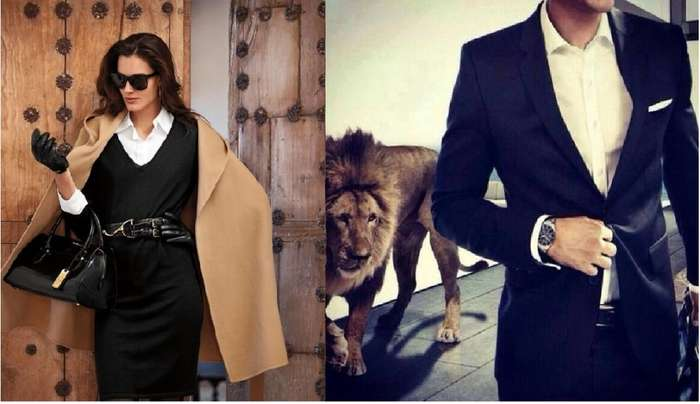

# “Загварын вант улс”-ыг үндэслэгч Джорджио Армани зөвлөж байна

Джорджио Армани- бүхэл бүтэн “загварын вант” улсыг үндэслэн, дэлхий нийтэд хүлээн зөвшөөрөгдөж, хувцасны хэв маяг, түүний цаад учрыг ч тунгаан өөрийн дотоод хүчиндээ итгэхийг уриалж байдаг нь түүний энэ зөвлөгөөнүүдээс харагдна.

-Дэгжин байх асуудал нь, хүний харцыг булаахад бус, харин хүний сэтгэлд тусахад зориулагдна\
-Хувцасны хэв маяг /стиль/, загвар /моод/ хоёрын ялгаа нь чанарт оршдог\
-Хямд гутал бол хэмнэлт биш. Хувцаслалтын гол үндэс, гутал байдаг.\
-Хувцасны хэв маяг нь, урт үргэлжилдэггүй загвараас яав ч чухал\
-Хувцас сонгохдоо хэт бүү хичээ. Стильтэй хүмүүс, хичээсэн юм шиг харагддаггүй.\
-Хар ба хар хөх өнгө хэзээд гуалиг харагдуулна.\
-Цаг бол их чухал зүйл гэж хэлмээр байна. Цаг таны тухай олон зүйлийг өгүүлдэг.\
-Бөс даавууг худалдан авахдаа,тод хээгүй, завсрын өнгийг сонгоорой. Хэзээ ч загвараас хоцрогддоггүй. \
-Таны үнэртэн, таныг өрөө тасалгаанд ороход, хүмүүс хамгийн түрүүнд хүлээж авдаг зүйл.\
-Хэт задгай хувцаслах нь, хүний өөртөө итгэлтэй байдлыг харуулах болов ч, тухайн хүний оюун ухааны хэмжээ, бие махбодын байдал хоёр нь ижил болохыг харуулдаг.
