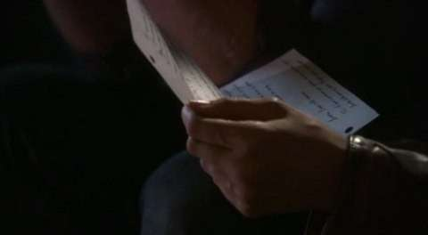

# Захирал нь, багш нартаа бичсэн захидал

Нэгэн сургуулийн захирал багш, багш нартаа энэхүү захидлыг бичиж, ажилд орж байгаа багш бүрт гардуулан өгдөг байжээ. Хэдийгээр энэ захидлыг бичсэн цаг үе, бидний амьдарч буй эрин үе биш ч гэлээ, хэзээ ч хуучирахгүй захиас сургамж гэдгийг, уншигч та, мөн багш нар маань, мэргэн оюундаа хүлээн авна гэж бодлоо.

Эрхэм хүндэт багшаа!\
Би, нэг ч хүн үзэх ёсгүйд тооцогдох зүйлсийг, аймшигт хорих лагерьт харж, үзэж шаналан давж гарсан хүн юм. Тэнд би, эрдэмтэд, инженерүүд хүн алах хийн зуухыг төлөвлөж боловсруулан барьж байхыг үзсэн. Тэнд би, мэргэжилийн эмч нар хүүхдүүдийг ялган, өвчин эмгэгтэйг нь ялган хийн зуух руу оруулж байхыг харсан. Сувилагч, асрагч нар нялх нярай хүүхдүүдийг алахыг харж байлаа. Дээд сургууль төгссөн залуус тэнд ажиллахыг, эмэгтэйчүүд, хүүхдүүдийг буудан хороож, галд шатаах ажил хийдэг боловсролтой алуурчидыг харсан. Тиймээс би тэр үеэс, хүнийг боловсролын түвшингээр харахаа больж, боловсролд итгэхээ больсон. Би, таныг гуйя. Сурагчидаа, хүн болоход нь хүн байхад нь туслахыг л танаас дахин гуйя. Таны хичээл зүтгэл, хэзээ ч, үргэлжийн мөнхөд, эрдэмтэн мангасууд, боловсролтой араатанлаг, гаж мэргэжилтэнгүүд, тангаргаа умартсан, гаж эмч, сувилагчид, боловсролтой гажигуудыг гаргахгүй, бий болгохгүй байхад орших юм. Таны заах, унших, бичих, тоо бодох хичээлүүд, зөвхөн, сурагчидын тань хүн болох, хүнлэг байх чанарт туслахаар, агуулга, зорилго, өгөөжтэй байгаасай гэж туйлаас хүснэм.\
Өнөөгийн эрин үе, мөн нийгэм маань, хэт технологийн хөгжилд улайран, материаллаг эд зүйлсийг дээдэлсээр, хүнлэг чанар, хүн ёсыг хүүхдийн хүмүүжилд суулгах чанарыг орхигдуулсаар байгаа нь нууцгүй юм. Наад зах нь, хүүхдүүд, сургуульдаа явах замдаа, чичирч даарсан гөлгийг хараад өрөвдөн, хүн чанар нь хөдлөн илэх гөлөг ч байхгүй, хөндий хүйтэн нийгэмд амьдарч байгаа маань хөөрхийлөлтэй ... Ядахдаа, амьтад, амьд бүхнийг хайрлах сэтгэлийг төрүүлэх, бид, хамгийн хэрцгий муу үйлдлийг араатантай зүйрлэдэг ч, араатан ч бие биенээ хайрлаж чаддаг атал, хүмүүст хомсдсоор байгаа тэрхүү Хайр гэх агуу зүйлийг хүүхдүүдийнхээ сэтгэл зүрхэнд суулгаж өгөхөд, томчууд бид хэн хүнгүй хичээх ёстой цаг иржээ.
