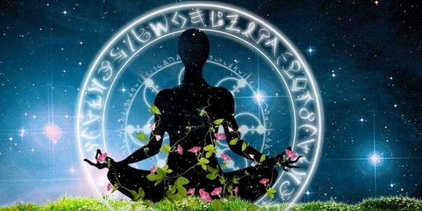

# Залхууралгүй уншиж, зайлшгүй мөрдүүштэй хамгийн ашигтай зөвлөгөөнүүд

Эрүүл мэнд:

1. Ус ахиухан уу

2. Өглөө нь хаан шиг цайлж, өдөр ханхүү шиг идэж орой нь ядуус шиг хоолло

3. Ургамлын гаралтай хүнс түлхүү хэрэглэх. Үйлдвэрийн аргаар боловсруулагдсан бүтээгдэхүүнээс аль болох татгалзах

4. Ямар ч хэлбэрийн тоглоом тоголж байхыг эрхэмлэ

5. Аль болох их ном уншиж байх

6. Өдөр бүр, ядахдаа 10 минут ганцаар нам гүм орчинд сууж байх

7. 7-8 цаг нойрсох /илүү ч үгүй, дутуу ч үгүй/

8. 10-30 минут явган алхах. Алхах үедээ инээмсэглэж байх

Хувь хүний хөгжил:

1. Өөрийн амьдралаа бусдынхтай харьцуулахгүй байх. Та, тэдгээр хүмүүс, юуг давж туулж энэ байдалд хүрсэнийг мэдэхгүй шүү дээ.

2. Хянах боломжгүй зүйлс болон аливаа сөрөг муу зүйлсийн талаар бодохгүй байх. Үүний оронд, эерэг бодит зүйлсэд энергиэ зарцуулж бай

3. Өөрийнхөө хэмжээ хязгаарыг мэдэж, боломжит зүйлсийг хийж бай

4. Өөртөө хэт шүүмжлэлтэй бүү ханд

5. Үнэт энергиэ хов живэнд бүү зарцуул

6. Мөрөөдөж бай

7. Атаархал дэмий хоосон цаг үрсэн зүйл. Танд, хэрэгтэй бүх зүйлс тань байдаг

8. Өнгөрсөн үеийн асуудлуудаа март. Бусдад мөн өнгөрсөн үеийн алдаа дутагдлуудыг нь сануулах зүйл бүү хэлж бай. Энэ нь, аз жаргалыг тань бусниулах хамгийн аймшигтай зүйл

9. Бусдыг үзэн ядахад цаг гарздах хэрэггүй. амьдрал маш богино

10. Амьдрал бол сургууль, та үүнийг таньж мэдэхийн тулд энд байгаа гэдгээ ойлго. Амьдралын асуудлууд нь, математикийн хичээл дээр мэдэж авсан зүйлс насан туршид хэрэглэгдэж байдгийн адил, бий болж эсвэл үгүй болж байдаг сургалтын хөтөлбөр юм

11. Таны аз жаргалтай байх эсэхийг, танаас өөр хүн хариуцахгүй

12. Их инээж, инээмсэглэж бай

13. Бүх зүйлд хожих албатай биш гэдгээ ухамсарла

Харилцаа:

1. Ойр дотныхонтойгоо байнгын харилцаатай бай

2. Өдөр бүр, бусдад, заавал ямар нэг сайн зүйл хийж байхыг эрмэлз

3. Бүхнийг, бүх зүйлийнх нь төлөө уучилж сур

4. Цаг хугацааныхаа ихэнхийг, 70-с дээш, 6-с доош насныхантай өнгөрүүлэдэг байхыг хичээ

5. Өдөрт, ядахдаа гурван хүнд инээмсэглэл бэлэглэ

6. Бусад хүмүүс таны тухай юу бодох нь танд огт хамаагүй, таны хэрэг биш

7. Ажил төрөл тань, таны эрүүл мэндийг бодож халамжилж чадахгүй. Өөрийгөө бодохоос гадна, ойр дотныхон, найз нөхөдтэйгээ байнга холбоотой байж сур

Амьдрал:

1. Өөртөө ашиггүй, гоё санагддаггүй, баяр хөөр төрүүлдэггүй зүйлсээсээ ангижирч сур

2. Нөхцөл байдал сайн ч байсан, муу ч байсан өөрчилөгдөн сэлгэгдэж байдгийг санаж бай

3. Сэтгэл санаа ямар байхаас хамаарахгүй, босч, хөдөлж урагшил

4. Хамаг сайхан зүйлс урд чинь байдаг

Таны дотор аз жаргал үргэлж байдаг. Тиймээс аз жаргалтай байгаарай

