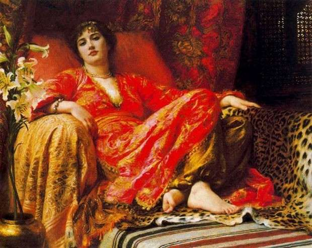
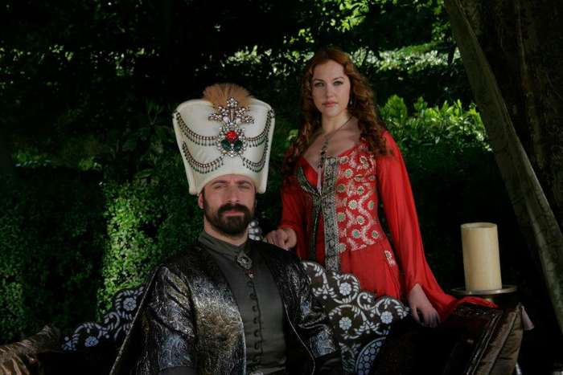

# Зальт Роксолана буюу Хюррем хатан

Туркийн султан Сулейман I-ийн хайртай эхнэр Роксоланад зориулсан хөшөө Украйны Ивано-Франковска районы төвд, 1999 онд нээгджээ. Энэ эмэгтэйг, “Гайхамшигт зуун” гэдэг туркийн олон ангит киноноос хүмүүс мэднэ. Энэ эмэгтэйн тухай хөөрөхийн тулд, багахан оршил хэлэх хэрэгтэй болж байна. Татвар эмс XV зууны үеийн Османы засаглалын үед бий болсон гэх бөгөөд орос, украйн, гүрж, хорватын бүсгүйчүүд л татвар эм болдог байжээ. Мөн, эхнэр болохоор бэлтгэгдэх бүсгүйчүүл хөрш орнуудын христийн шашинтай байх ёстой гэсэн шаардлага тавигддаг байв. Султаны татвар эмсийн тэргүүн нь шахын эх байсан гэдэг. Татвар эм болох хэцүү биш ч, харин тэдний дундаас онцгойрч сонгогдох нь хэцүү байдаг байж. Султаны эхнэр байхын тулд, ухаантай мөн гоо үзэсгэлэнтэй байх ёстой. Гэхдээ энэ хоёр шалгуур нь гадаад байдал учираас хамгийн зальтай хүүхнүүд л санасандаа хүрч султаны эхнэр болж байсан байдаг. Эдгээр татвар эмсийн хамгийн алдартай нь украйн гүнж /оросоос, польшоос гаралтай гэсэн гар бичмэлүүд байдаг аж/ Зальт Роксолана байжээ. Тэрээр, 40 жилийн турш, 300-д татвар эмсийг нь мартуулж, Сулейман султаны эхнэр байсан бөгөөд өөрийн байр суурийг бэхжүүлэхийн тулд Сулейманд 3 хүү төрүүлж өгсөн гэдэг. Тэр Хюррем Хасеки-султан гэж нэрлэгдсэн бөгөөд. Европд Роксолана нэрээр мэддэг. Жинхэнэ нэр нь Анастасия эсвэл Александра Гавриловна Лисовская гэдэг, 1502, 1505 оны аль нэгэнд, Украйны Рутения гэдэг газар төрсөн гэж хожим түүхчид тогтоосон байдаг. Уг газар нь одоогийн Ивано-Франковск гэж үздэг. 1558 онд Османы эзэнт гүрний Стамбулд хордсон байх магадлалтай удаанаар өвчилж байгаад нас нөгцсөн гэж үздэг. Татаруудад олзлогдсон байхад нь, түүнийг султанд бэлгэлсэн гэх нь бий. Уран зохиолд янз бүрээр илэрхийлсэн байх нь тааралддаг гэнэ. 1534 оны үед тэр шахын албан ёсны эхнэр болсон. Түүний бунхан Сулейман султаны бунханы зүүн талд бараг зэрэгцэн оршдог. Тэр үед, Шахын журмын дагуу султан 4 эхнэртэй байж болно, харин анхны эхнэрийн том хүү хаан ширээ залгамжлах тул, бусад агиудыг өчиггүй хороодог харгис журамтай байв. Тиймээс, Роксоланагийн хувьд, шахын анхны эхнэрийн хүүхдүүд хамгийн том дайсан болж байсан бөгөөд нэгэн аймшигт хуйвалдааны талаар олж мэдсэнээ Сулейманд хэлснээр тэдгээр хөвгүүдээс салж, хадам эхээ хорлож, сулейманы бусад хөвгүүдийг ч эрж олон нууцаар амийг нь хороож байсан байдаг. Османы ордны хуулиар, татвар эм нэгээс илүү хүү төрүүлж болохгүй гэсэн журмыг зөрчин хэрхэн 3 хүү гаргаж, амьд мэнд үлдээж өсгөснийг нь түүхчид тайлбарлаж чаддаггүй. Барууны түүхэнд түүнийг, Султанд илбэ жатга хийж эрхээрээ байлгадаг байсан гэж бичсэн байдаг гэнэ.

