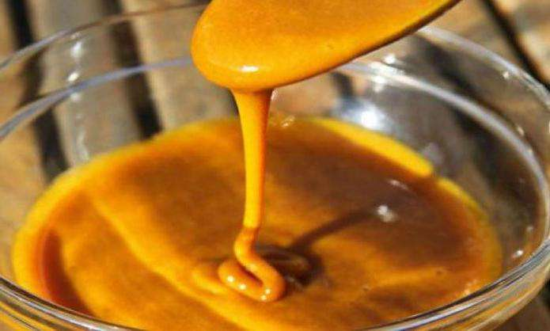

# Залуужуулах хүчтэй үйлчилгээтэй ургамал

Эртний санскрит хэл дээр, куркумаг “биеэс муу сүнсийг зайлуулагч”, “биеийн өнгө төрх биеийн бүтцийг сайжруулагч”, “арьсыг цэвэрлэгч, гэгээ татуулагч”, “одот тэнгэрийн үзэсгэлэнг дагуулагч” гэх мэтээр тодорхойлсон байдаг. Куркума – эмчилгээний маш хүчтэй чанарыг агуулдаг бөгөөд хорт хавдарыг зогсоох чадвартай гэдэг. Удаанаар өвдсөн, хэвтэрт байсан хүнийг хөл дээр нь босгох сэргээх гайхалтай чанартай байдаг аж. Цусыг цэвэрлэж, цусны эргэлтийг сайжруулан, цусны шинэ эд эсийг үүсгэдэг. Мөн биеэс хор гадагшлуулж, хордлого тайлдаг ба анагаахад, хорын эсрэг, эд эсийг эдгээх зориулалтаар ашигладаг. Куркума нь, гэдэсний ялзралын процессыг дарж, илүүдэл салстыг гадагшлуулахаас гадна ходоод гэдэсний үйл ажиллагааг сайжруулж, нойр булчирхайг дэмждэг. Мөн бактерийн эсрэг үйлчлэлтэй ба бодисын солилцоог сайжруулдаг жинхэнэ байгалийн антибиотик юм. хоол боловсруулалтыг сайжруулан, гэдэсний дүүрэнгийг дарж, гэдэсний эрүүл бичил орчинг дэмждэг. Ходоод, арван хоёр нугалмай гэдэсний шархыг эмчилдэг. Мөн, арьсны өвчнийг гайхалтай эмчилдэг. Зуурч бэлдсэн куркума, экзем, маажуурыг эмчлэхээс гадна хатигт тавихад хурдан эдгээдэг. Бие цэвэрлэхэд, оройд халуун сүүнд цайны халбаганы талыг хутгаж уудаг. Залуужуулах үйлчилгээ:\
Бага хэмжээгээр хэрэглэхэд л, организм дах чөлөөт радикалуудыг устгах үйлчлэл үзүүлдэг бөгөөд энэ нь хөгшрөлтийг зогсоодог. Тогтмол хэрэглэснээр үрчлээс үүсэхээс хамгаалагдах бөгөөд царайны өнгийг сайхан болгож, арьс цэвэрлэгдэж, арьснытолбо сорви, хагалгааны дараах сорви арилдаг байна. Залуужуулах маска:\
1.1 цайны халбага куркума, 1 цайны халбага сүү, 1 цайны халбага зөгийн балыг хольж нүүрэндээ түрхэн 10-30 минут болгоод угаана.\
2. 1 цайны халбага куркума, 1 хоолны халбага сүүг хольж нүүрэндээ түрхээд 30 минут болгоод угаана. . Нэг өдөр өнжөөд хэрэглэх хэрэгтэй. 2-3 масканы дараа мэдэгдэхүйц үр дүн харагддаг
