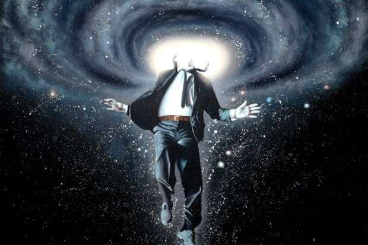

# “Заяа”

Нэгэн эрэгтэй автобусанд зогсон явна. Тэр, “Эхнэр-тэнэг, найзууд гэж новшнууд, амьдрал ёстой хог” гэж бодон явах бөгөөд ард нь зогсох “Заяа” хэмээх сахиусан тэнгэр нь, -“Ямар хачин юм бодож хүсдэг юм бэ, хамгийн гол нь өдөр бүр байнга бодох юм. Одоо яая гэх вэ, биелүүлэхээс л биш” гэж тэмдэглэн авах аж.\
Хүмүүсээ! Сайн, сайхан зүйл бодож явахгүй бол болохгүй нь байна шүү. Заяа нь, залхаад хаясан хүн гэж байдаг гэсэн, ам дамжсан урдны үг ортой байх нь...
