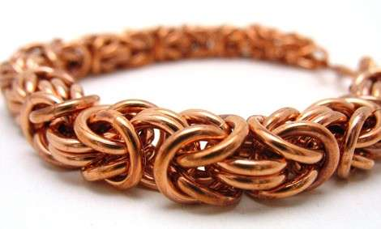
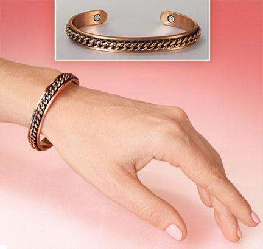

# Зэс бугуйвч эрүүл мэндэд ашигтай

Эртний Египетийн фараонууд болон тэдний ойр дотныхон нь домч нарынхаа шаардлагаар гартаа зэс бугуйвч зүүдэг байжээ. Тэд зэс бугуйвчийг өвчин эмгэг, гай зовлонгоос зайлуулагч шидэт сахиус хэмээн үздэг байсан юм. Египетүүдийн ч зөв байлаа. Хүн зэс хэмээх элементгүйгээр аль ч утгаараа оршин тогтнох боломжгүй юм.

Өнөө үед мөнгө, зэс, циркони зэрэг металлуудын эмчилгээний чанарын талаар их ярих болсон. Үүнийг дагаад чухам ямар металл хүний эрүүл мэндэд хамгийн чухал гэдгийг хэн ч мэддэгггүй. Энэ металл бол зэс гэж шинждэх ухаан баталжээ.\
Хүний биед хоногт гурваас дөрөвхөн мг зэс шаардагддаг хэдий ч түүнгүйгээр оршин тогтнох боломжгүй юм. Зөв, тогтмол бус хооллох, ходоод гэдэсний замын архаг өвчнүүд, бүх төрлийн хоолны дэглэм нь биен дэх зэсийн хэмжээг багасгадаг. Тиймээс ч орчин үед ихэнх хүмүүсийн биед зэсийн хурц дутагдал ажиглагддаг. Ингэснээр цусан дахь гемоглобины хэмжээ багасах, хэмнэл алдагдах, зүрх судасны өвчинд нэрвэгдэх, чихрийн шижин, сэтгэц мэдрэлийн хямрал тусах, янз бүрийн халдварт өвчингүүдийг эсэргүүцэх чадвар буурах, толгой өвдөх, хурдан ядрах, сэтгэл санаа тавгүйдэх зэрэг аюултай. Зэс дутагдсанаар зүрх судасны хэмнэл алдаглах, ясны системийн өвчин, хавдрын өвчин тусдаг. \
Зэс хүний биеийн эдэд багасахад улаан чонын яр тусна. Энэ металл гемоглобиныг үүсгэхэд шаардлагатай учир элгэнд хуримтлагдах төмрийг идэвхижүүлдэг. Үүнээс гадна зэс нь нугасанд цус бүрэлдэх явцад түлхэц өгдөг. \
Энэхүү металлын дутагдлыг биед тэнцвэржүүлэх хэрэгтэй гэдэгт эрдэмтэд санал нэгддэг. Ингэхийн тулд зэс бугуйвч гартаа зүүх египетийн хаадын аргыг хэрэглэх нь зүйтэй. Орчин үеийн шнжлэх ухаан зэс бугуйвч зүүхийн ашигтай талыг баталсан. Тиймээс өнөө үед зэс бугуйвч их түгэн дэлгэрч байгаа билээ. \
Зэс бугуйвчийг баруун гартаа зүүхэд толгой өвдөх, нойргүйдэх, артерийн даралт багасах, чихрийн шижин, сүрье, сексийн хямрал, бронхит, астма зэрэг өвчнүүд багасна. \
Харин зүүн гартаа зүүхэд артерийн даралт ихсэх, зүрх судасны ханын өвчнүүд, зүрхний дутагдал, шамбарам зэрэг өвчнүүд буурна.
