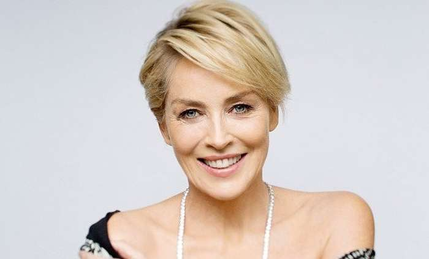

# Үзэсгэлэнт Шерон Стоуны гайхалтай ухаалаг зөвлөгөө

Алдарт жүжигчин Шерон Стоуныг энэ зөвлөгөөнийх нь төлөө тэврээд үнсмээр... Тэрээр ийнхүү бичиж нийтлүүлжээ.

-Тиймээ, би хөгширч байна. Гэхдээ би үүнд эмзэглэдэггүй, бараг л таатай байна. Амьдралын эхний хагаст, хүний нүүр царай төрөлх төрхөөрөө байдаг. Харин сүүлийн хагаст нүүр төрх чинь хэрхэн амьдарсныг харуулдаг. Би өөрийгөө тийм ч дур татам гэж боддоггүй байсан. Харин одоо тоглосон кинонуудаа үзээд үнэхээр аятайхан эмэгтэй гэдгээ мэдэж авч байна. Надад насаа нуух шаардлага байхгүй. Өөрийнхөө насанд, насандаа таарсан сайхан харагдахыг л хүсч байна. Дөч гараад, гартаа хундага дарстай толиныхоо өмнө, -“Би, өөрийнхөө өөрчилөгдөн буй гадаад төрхөө байгаагаар нь хүлээж авахаас нааш гадагш гарахгүй” гэж амлаж байж билээ. Одоо инээд хүрдэгч, зөв зүйл хийсэн гэж санагддаг. Би харин, амьдралын хамгийн чухал зүйл болох эрүүл мэнд минь сайн байдагт бурханд талархаж явдаг. Тэгээд ч би, ирж буй өтөл насандаа хайртай. 16 жилийн өмнө, цус харваж, 9 хоногийн турш тархины минь судас цусаар шүүрч байсан ч би амьд үлдсэн. Ийм өвчтэй олон ч хүн дэргэд минь өөд болсон. Үүний дараа би, 2 жилийн турш дахин явж сурах, ярих, унших бичиж сурах оролдлогууд хийж байх үедээ, үрчлээс бол үнэхээр инээдтэй хоосон зүйл гэдгийг ойлгосон. У,Черчиллийн “Хэрэв чамд тамаар дайран өнгөрөх хэрэг гарвал хурдхан туулж өнгөр” гэсэн үг их тус болдог. Энэ дэлхий дээр, хэзээ ч төгс зохирол байхгүй. Харин энэхүү зохирол зөвхөн, тархи сэтгэхүй, толгой дотор байдаг. Тиймээс ч юм уу, би үнэрт тоснуудад их дуртай. Эх оронд минь, 400 000 орчим, зузаан уруул, хиймэл хацрын хонхорхойтой, цайвар үстэй, ижилхэн хиймэл царайтай бүсгүйчүүд амьдардаг гэсэн судалгааг уншаад, хүмүүс тэднийг сайхан, өвөрмөц төрхтэй, дур булаам гэж тооцдог юм байхдаа гэж их гайхдаг. Охин шиг байхыг эрмэлздэггүй, эмэгтэйлэг, байгаа төрхөөрөө эмэгтэй байх л хамгийн сайхан. Өсч буй хүүхдүүдээ харахаар, өөрийгөө амьд, мөн оршин буйгаа улам ихээр мэдрэх юм. Би, гоо үзэсгэлэн дотроос ундарч байдаг болохыг 58 насандаа л мэдлээ. Гоо үзэсгэлэнтэй байж, түүнийгээ хадгалж үлдэхийн тулд, хүсдэг дуртай зүйлээ хийж, бүтээлч байх нь л чухал. Жишээ нь би, амьдралыг бүжиггүйгээр төсөөлж чаддаггүй.

