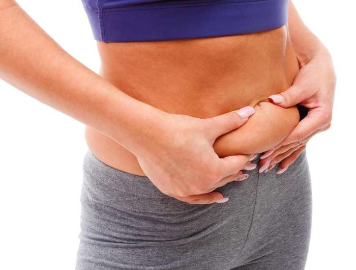

# “Зэвүүн” гэдэснээс салах арга

Дараах ургамлын холимог нь, унжсан гэдэснээс салгаад зогсохгүй, биеийн эрүүл мэндэд сайнаар нөлөөлдөг. Мөн эрч хүч нэмж, арьсны бүтэц сайжирч буй нь богино хугацаанд анзаарагддаг.

**Орц:**\
Ус - 1 литр\
Нимбэгний хүчил - 4 хоолны халбага\
Стевия - 1 хоолны халбага\
Цагаан гаа /нунтаг/ - ½ хоолны халбага\
Улаан перец /нунтаг/ - ½ цайны халбага\
Куркума 1 хоолны халбага\
**Бэлтгэх:**\
Усаа буцалгаад 5 минут орчим тавиад, тусад нь, саванд хольсон орцууд дээрээ нэмж сайтар хутгана.\
**Хэрэглэх:**\
Бэлтгэсэн хандаа өдрийн турш ууж хэрэглэнэ. Эхний 10 хоногт үр дүн гардаг. Хүссэн байдалдаа хүрэх хүртлээ бэлтгэж хэрэглэдэг.
