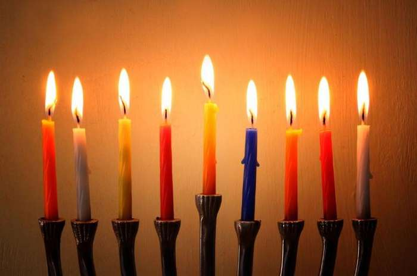
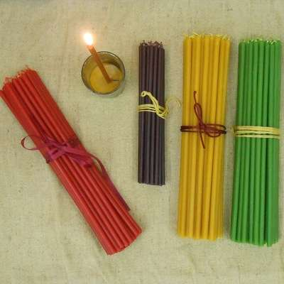

# Зөгийн лаван лаа: Ямар өнгийн лаа мөнгө, хайр, амжилт дууддаг вэ?

Лааг эрт дээр үеэс орон байр, өрөө тасалгааг гэрэлтүүлэгч болгон ашиглаж ирсэн бөгөөд харанхуйг ялах, хар мууг дарах увидастай гэж үзсээр иржээ. Лааны тусламжтай галын увидасыг нь ашигласан хайр дурлалтай учирах, чинээлэг хангалуун байдлаа өсгөх, таагүй зүйлсээс хамгаалах, агаар цэвэршүүлэх зэрэг зориулалтаар зөгийн лаван лааг хэргэлдэг байна. Үүнд, лааны өнгө болон лааны бүтээгдсэн материалыг онцгойлон тооцдог, мөн тухайн зорилго тус бүрт тодорхой өнгийн лааг асаадаг гэдэг. Зөгийн лавыг байгалийн гаралтай, амьд хүчтэй гэж үздэгээс уг зүйлээр хийсэн лаа, галтай хамт увидастай болдог гэдэг бөгөөд ийм лааг асааж байх нь, гэр орны энергийг өөрчилж, түүнийг даган амьдралд нөлөөлдөг аж. Тухайн байр байдал, хүсэл зорилгодоо тохируулан лааны өнгийг сонгон асааж байхыг зөвлөдөг:

Цагаан өнгийн лаа\
Хамгаалалтын зан үйлд хэрэглэж ирсэн байдаг. Тайвшруулах, хоорондын таарамж, зохилдлогоо сайжруулах увидастай тул, унтлагын өрөөнд асаахыг зөвлөдөг. Хэрүүл маргааныг дарах, эвлэрүүлэх увидастай. Дөлийг нь тогтож харах, удаанаар ширтэх үед тайвшруулж бясалгалын хэмжээнд үйлчилдэг.\
Шар өнгийн лаа\
Ийм өнгийн лаа гэр орны энергийг хүчтэй сэргээж, сөрөг энергийг зайлуулж сайн сайхныг татна. Мөн хүний сэтгэл санаанд эерэгээр нөлөөлж, бие организмын дотоод энергийг өсгөдөг. Үнэртэн, арц хүж, үнэрт тос зэргийг хамт хэрэглэх нь илүү үр дүн дагуулна гэдэг. Идэвхитэй үйл ажиллагаа, бүтээлч сэтгэлгээ, харилцааны чадврыг өсгөдөг.\
Улаан өнгийн лаа\
Энэ өнгийг хүсэл тачаалын өнгө гэдэг. Зан үйлд, дур хүсэл сэргээх, дур татах, зорилгоо биелүүлэх, мөн хамгаалалтын зориулалтаар хэргэлж ирсэн байдаг. Бие организмыг хатжуулж, нөхцөл байдал дах сөрөг зүйлсийг даван туулах, хяналтад байлгах, өөрчилөх, энергийн алдагдлыг зогсоох увидастай. Асаасан улаан лаагаар гэр орон өрөө тасалгаагаа тойруулж ариутгах үйлдэл нь сөрөг энергийг зайлуулдаг. Зогсонги байдлаас гарахад тустай. Мягмар гаригт асаах, хүчтэй үйлчилэлтэй.\
Улбар шар өнгийн лаа\
Аз завшааны өнгө. Ийм өнгийн лааг хариуцлагатай арга хэмжээ, гэрээ хэлэлцээр, ажил төрөл бүтээхийн өмнө өөрт ашигтай шийдүүлэх зорилгоор асаадаг. \
Ногоон өнгийн лаа\
Мөнгөний өнгө. Гэр орондоо ногоон өнгийн лаа асаах нь, санхүүгийн асуудлаа засах, өсгөх хүслээ ертөнцөд илгээж байна гэсэн үг гэнэ. Ногоон өнгийн лаа асааж дөлөн дээр нь хэтэвчээ гурав эргүүлэх нь хоосрол, алдагдлаас хамгаалах арга гэдэг. Мөн энэ өнгийг эрүүл мэндийн өнгө гэдгээс, өвдөхгүй байх, энергиэ алдахаас сэргийлэх үүднээс унтлагын өрөөнд асааж байх хэрэгтэй гэдэг байна.\
Цэнхэр өнгийн лаа\
Зөн совингийн өнгө. Таатай өөрчлөлтүүдийг татах, өөрийгөө таних, дотор бодлууд цэвэрлэгдэх, буруу зуршлуудаа дарах, айдас түгшүүрээс салахын тулд асаадаг. Ясны хугарлын үед асаах эдгэрэлтэд нөлөөлдөг гэдэг. \
Нил ягаан өнгийн лаа\
Нууцлаг байдлыг илэрхийлнэ. 6-дах мэдрэхүйг сэргээж, улаан лаатай хамт асаахад, улаан өнгө эрч хүчийг өсгөдөг тул дотоод энергийг чөлөөлж өгдөг.\
Алтлаг,мөнгөлөг өнгийн лаа\
Баяр ёслолын өнгө. Ийм лааг хүслээ тодорхойлох, төсөөллөө идэвхижүүлэхэд хэргэлдэг. \
Хар өнгийн лаа\
Хаад, эрх мэдлийн өнгө. Хараал жатга хийхэд ашиглахаас гадна, хариулга хийхэд хэргэлдэг. Хамгаалалтын хүчтэй хэрэгсэл гэж үздэг. Хараал хэл амыг шингээж зогсоодог. Бямба гаригт хүчтэй үйлчилэлтэй.\
Бор өнгийн лаа\
Тогтвортой байдлыг хадгалахад тустай. Унтлагын өрөөнд асаадаг\
Хувийн амьдралдаа өөрчилөлт хийхийг хүсвэл, тухайн хүсч буй өөрчилөлт хийх хүсэлдээ тохирсон өнгийн лааг асааж, хүслээ цэвэр цаасан дээр бичиж шатаах арга өргөн хэрэглэгддэг байна. Өнгийн лаа ашигласан зан үйл нь маш хүчтэй гэж үздэгээс зөвхөн сайн хүсэл, сайн санааны зорилгоор ашиглах хэрэгтэй бөгөөд эсрэг тохиолдолд, эргэж буух, буцаж ирэх аюултай гэж зөвлөдөг. Аливаа зан үйл нь, хүмүүсийн ухамсарт дээд тайлагдашгүй хүчинд тооцогддог, байгаль дэлхийн таагдашгүй, нууцлаг онцгой хүчин зүйлсийн увидасыг ашиглан амьдралыг өөрчилөхөд зориулан хийгддэг арга, нэг төрлийн эртнээс уламжлан ирсэн урлаг юм гэж үздэг байна.
