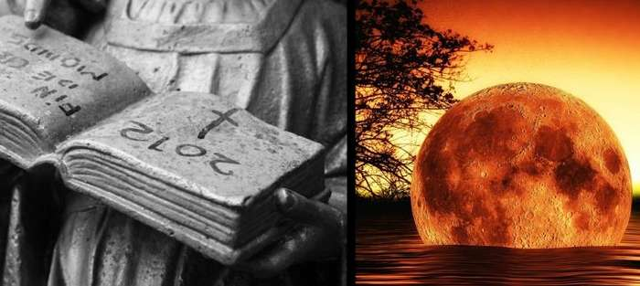
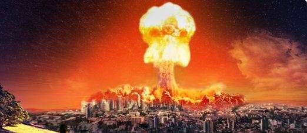
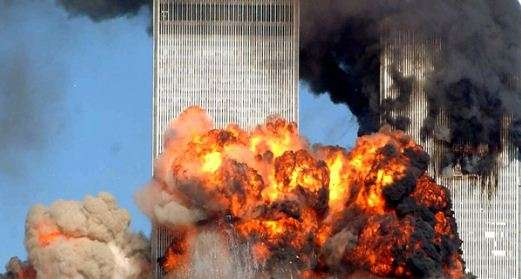
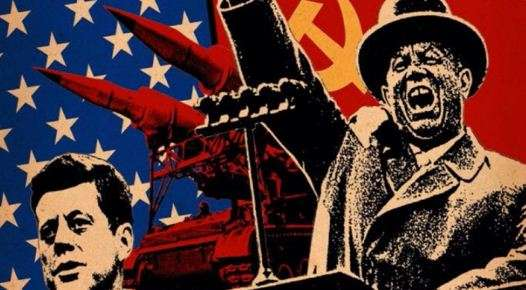
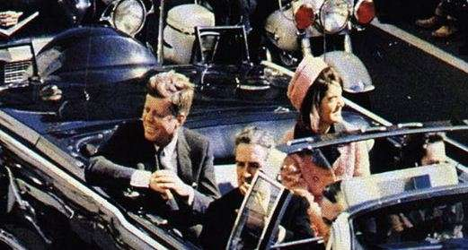
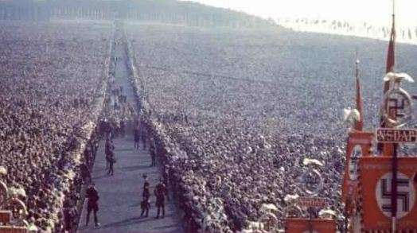
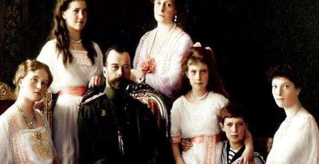
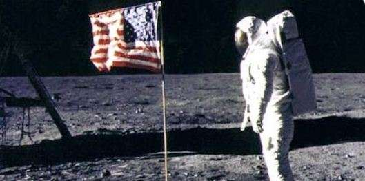
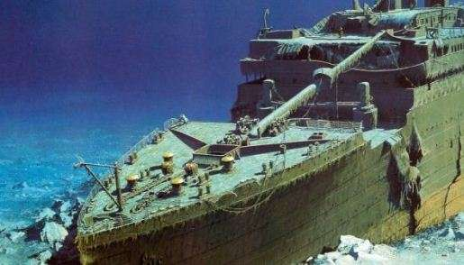

# Зөгнөл биелсэн гайхмаар тохиолдлууд

Ирээдүйд болох үйл явдлуудыг урьдчилан хэлж зөгнөн, тэдгээр нь биелсэн тохиолдлууд олон байдаг ч дараах үйл явдлууд хэн, хэдийд хэлсэн нь тодорхой, түүнчилэн тухайн болж өнгөрсөн үйл явдлуудын нөхцөл, явцуудтай бараг нарийвчилалтай таарч байдгаараа олныг гайхшруулсаар байдаг юм. Аливаа урьдчилан харж хэлсэн, зөгнөн бичсэн зүйлсийг хүмүүс, биелээгүй үед нь, тохуурхаж, шоглосон аястай хандсан байдаг. Харин өнөөдөр, тэрхүү гайхалтай чадвартай хүмүүсийн хэдэн арав, зуун жилийн өмнө зөгнөн хэлж байсан нь эдүгээ биелсэний гэрч болцгоож байгаа маань гайхаад баршгүй.

Атомын бөмбөг. Английн зөгнөлт зохиолч Герберт Уэллс, 1914 онд “Чөлөөлөгдсөн ертөнц” номдоо энэхүү үхлийн зэвсгийг тодорхой дүрслэн бичсэн байдаг байна.

---

9 сарын 11-ний халдлага. Нострадамус тэмдэглэлдээ Нью-Йоркод тэнгэрээс төмөр шувуу унасан талаар бичиж, мөн Болгарийн зөнч Ванга Нью-Йоркийн энэхүү эмгэнэлт явдлыг урьдчилан харж сануулж байсан байдаг.

---

Хүйтэн дайн. 1840 онд, францийн улс төрч Алексис де Токвиль дэлхийн хувь заяа хоёр том гүрэн, тэр үед бараг сураггүй байсан Америк Оросын гарт хуваагдна гэсэн нийтлэл бичиж бөөн шуугиан болгож байжээ.

---

Кеннедийн аллага. Джон Кеннедийн үхлийг, америкийн зурхайч, зөнч Джин джексон урьдчилан хэлж байсан нь тэмдэглэгдэн үлдсэн байна.

---

Дэлхийн 2-р дайн Америкийн зөн билэгтэн Эдгар Кейс трансад орсон үедээ бичиж байсан тэмдэглэлд, дэлхийн хоёрдугаар дайны талаар зөгнөн бичсэн зүйлсийнх нь он сар өдөр хүртэл таарч байдаг нь гайхаш төрүүлээд зогсохгүй, явцыг нь хүртэл тодорхой дүрслэн бичсэн байдаг байна.

---

Оросын хаант улсын мөхөл. 1917 онд болсон хааны гэр бүлийн аллага, хаант засгийн мөхлийг олон жилийн өмнө хамба лам Серафим Саровский зөгнөн хэлж байжээ. Мөн Г.Распутины уг үйл явдал болохоос өмнөх тэмдэглэлд дурдагдсан байдаг нь сонин.

---

Саран дээр буусан үйл явдал Францийн зөгнөлт зохиолч Жюль Верн, саран дээр америкчууд очихоос 100 жилийн өмнө, энэ үйл явдлыг “Дэлхийгээс сар хүртэл” номондоо тодорхой дүрслэн бичсэн бөгөөд зарим зүйлс гайхалтай нарийвчилалтай таардаг байна.

---

Сошиал сүлжээ. Америкийн зөгнөлт зохиолч Рэй Бредбери, 1953 онд бичсэн “Фаренгейтын 451 градус” номондоо дэлхийн хүмүүс зайнаас харилцдаг болох технологийг гайхалтай нарийвчилалтай дүрслэн үзүүлсэн байдаг гэнэ.

---

Титаникийн сүйрэл. Зохиолч Морган Робертсон 1898 онд бичсэн “Нарийвчилал” номондоо “Титан” хэмээх хөлөг Атлантын далайд хэрхэн сүйрснийг дүрслэн бичсэн бөгөөд 14 жилийн дараа Титаник хөлөг мөн ийм байдлаар сүйрсэн байна.

---

Ихэнхи зөгнөл, урьдчилан харж хэлсэн зүйлсийг зөнч, зөн билэгтнүүд гэхээсээ зохиолчид бичсэн байгаа нь сонирхол татдаг. Та ч гэсэн бодолдоо болгоомжтой хандах хэрэгтэй бусуу. Биелэхгүй гэх газаргүй...
