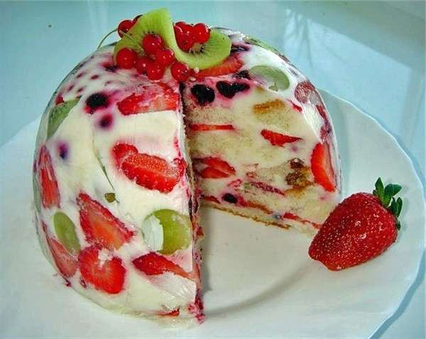

# Жигнэж, болгох шаардлагагүй жимсний торт

Шарах шүүгээнд жигнэж болгох шаардлагагүй, хийхэд хялбар энэхүү амттан ширээг тань чимж, ур чадварыг тань гайхуулах бус уу?

Орц:\
Цөцгий 500гр\
Элсэн чихэр 150гр\
Желатин 20гр\
Ваниль 1 уут\
Жимс, жимсгэнэ 300 гр\
Желатин дээрээ 2 хоолны халбага хүйтэн ус хийнэ. Хөөж өсмөгц нь, багахан бүлээн ус хийж шингэлнэ. Гүнзгий ёроолтой саванд, цөцгийгөө хийж, ваниль, сахар хоёроо нэмж өтгөртөл хутгана, үүн дээрээ желатин, жимсүүдээ хийж холиод, өөр гүнзгий ёроолтой саванд хүнсний гялгар уут дэвсэж, юүлнэ. Илүүдэж тунасан цөцгийг нь, энэ үед бага зэрэг хасаж болно. Мөн, жимсийг өөр зүйлүүд болох, жигнэмэг, крекер, шоколадны үйрмэг зэргээр орлуулах, эсвэл нэмж өгч болно.
