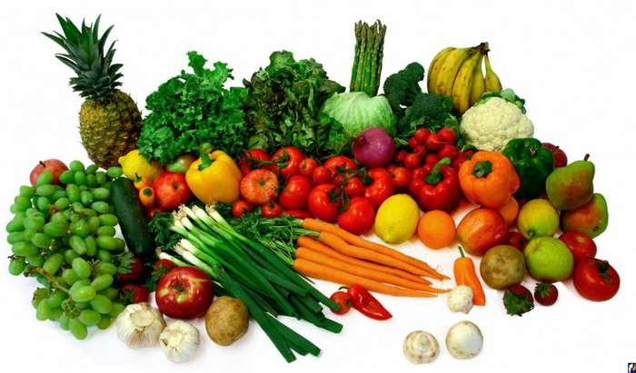
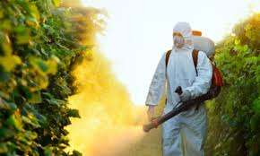

# Жимс, ногоог аюулт пестицидээс хэрхэн цэвэрлэж хэрэглэх вэ?

Жимс, ногоог ургуулах үедээ пестицид гэдэг бордоо хэрэглэдэг байна. Энэ бодис усаар угаахад арилдаггүй гэнэ. Дараах хоёр аргаар жимс ногоог цэвэрлэж хэрэглэх нь бие организмаа хордуулахаас хамгаалдаг байна.

-Ус, уксусыг 3:1 харьцаатай найруулж, уг уусмалаа цацагчтай саванд хийж жимс, ногоогоо шүршээд 10-д минут байлгаад, усаар сайтар угаадаг. Энэ бол хүчтэй арга. -1 хоолны халбага нимбэгийн хүчил, 2 хоолны халбага сода, 1 стакан усыг мөн найруулж, түүгээрээ угааж цэвэрлэдэг. Хэрэв пестицид ихтэй гэдгийг мэдэж байгаа тохиолдолд, хальсалж идэхийг зөвлөдөг.
