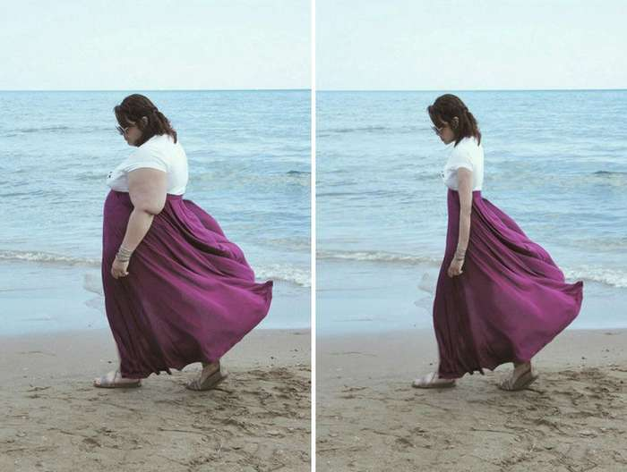
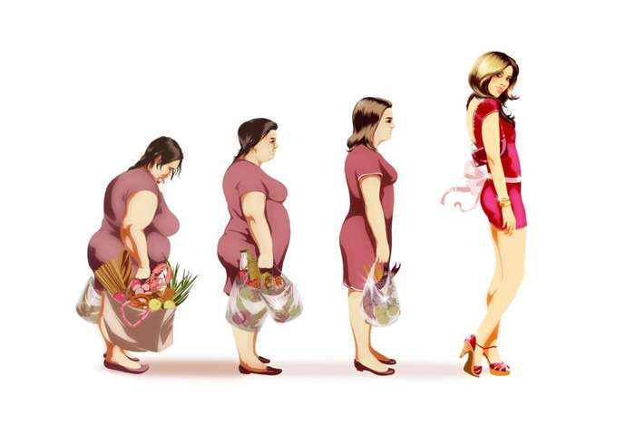

# Жин хасахын тухайд!!!

Эстонийн хүний биологи, экологийн төвийн захирал Г.Гроссман, 21 жилийн турш хүний эрүүл мэнд, биеийн жингийн харьцуулсан судалгаа хийж, олон хүмүүсийг эрүүлжүүлж яваа эмч хүн бөгөөд тэрээр, хатуухан зөвлөгөө өгчээ. Эмэгтэйчүүдийн дунд, жин хасах талаар мөн турах арга эрэлхийлсэн яриа байнга явагдаж байдаг. Мөн, 165 см өндөртэй, 60 кг-тай атлаа, багахан цондгор гэдэс гарсны төлөө турах асуудлаар над руу олноор ханддаг. Тэднийг би их сайшаадаг юм. Ийм хүмүүсийн хувьд турах, жин хасах гэж зорих нь зөв юм. Тэд, бариу хувцас өмсөх боломжоо алдахгүйн тулд хичээцгээж, үүний зэрэгцээ үнэлшгүй үнэ цэнтэй эрүүл мэнддээ ихээхэн ач тус хийж байна гэсэн үг юм. Харин 100-с дээш жинтэй хүмүүсийн хувьд, жин хасах биш өвчинөө эмчилнэ гэж зорих нь илүү үнэнд нийцнэ. Энэ бол өвчин. Эрүүл байхыг хүсвэл, аль ч насандаа хэвийн жин, бүр төгс жингээ барих хэрэгтэй. Удаанаар илүүдэл жинтэй явж, эрүүл мэндээ муутгах хэрэггүй, удаанаар өвчилөх өвчилөлд хүргэнэ. Ийм хүмүүсийг эрүүлж, эсвэл үх гэсэн хандлага гаргадаг байсан цаг үе урд өмнөх зуунуудад байсан гэдэг. Харин, одооны илүү энэрэнгүй нийгмийн үед юутай ч, эрүүлжих эсвэл тахир дутуугийн группэд орох гэсэн боломж олгох болсон. Энэ тийм таатай зүйл биш гэдэгтэй санал нэгднэ гэдэгт итгэлтэй байна. Мөн жинг нас ахихын хирээр нэмэгдэж байх ёстой гэсэн ойлголт бол маш буруу. Хүний төгс жин бол 25 настай байх үеийн жин гэж, олон зуун туршилт судалгааны үр дүнгээр нотлогдоод байна. 165см өндөртэй хүн 60-с илүүгүй жинтэй байх ёстой. Тиймээс, эрүүл байхыг хүсвэл биеийн жингээ төгс хадгал. Хэрвээ илүүдэл жинтэй болчихсон бол, жингээ үе шаттайгаар, зугуухан хасах буюу 4-6 долоо хоног турах дэглэм барьж, дараагийн нэг сар жингээ тогтворжуулан барих маягаар, хэд хэдэн удаа давтаж, жингээ бие организмдаа дасгаж турах хэрэгтэй. Хир их жингээ хасна, төдийчинээ эрүүл болох болно. Биеийн жиндээ эртнээс анхаарч байх нь эрүүл байхын үндэс гэж хэлмээр байна, гээд мөн одоогийн 25 настнуудыг, одооноос биеийн жингээ хэвээр нь барихад анхаараасай гэж уриалжээ.

