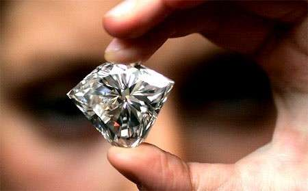

# Жинхэнэ бриллиантыг ялгах 15 шинж

Юуны өмнө, гоёл чимэглэлийн дээд энэхүү хосгүй үнэт чулууг таних, хуурмагаас ялгах энэхүү мэдээлэл сонирхолыг тань татаж уншиж байгаад тань баяр хүргэе. Магадгүй энэ хосгүй үнэт чулуу танд байдаг байх эсвэл танд тун удахгүй бий болох нь. Мөн, эмэгтэй хүний хувьд, гэр орны эд хэрэглэл худалдан авах, гоо сайхны бүтээгдэхүүн сонгох зэрэгтэй харьцуулахад хамаагүй гоё, тааламжтай мэдээ хүргэж буйдаа баяртай байна.

1. Сертифкаттай байх ёстой. Тухайн чулууг жинхэнэ болохыг нотолсон сертификаттай байх нь чухал. Ямар ч үнэт эдлэлийг, худалдан авагч авсныхаа дараа сэтгэл амар байх, сэтгэл хангалуун байхад хэрэгтэй сорьц, нотолгоо баримт дагалдах ёстой.\
2. Хурц гялбаа. Чулууг нэвт харах гээд үз. Алмаз маш өндөр гэрэл хугалах, ойлгох чадвартай учираас маш хурц гялалзаж байдаг. Ямар ч эрдэслэг, шилийг хичнээн нарийн засаж янзалсан ч гэрэл хугалах чадвар нь бага учираас гялалзаж цацрах нь сул байдаг.\
3. Тунгалаг байдал. Хэрэв бриллиант тань, хүрээ чимэггүй бол хавтгай талаар нь сонин эсвэл сэтгүүл дээр тавиад хар. Хэрэв, цаад бичиг, үсэг нэвт харагдаж байвал бриллиант биш.\
4. Хэрэв хүрээ чимэгтэй тохиолдолд, зассан талстуудын орой, ирмэг нэвт харагдахгүй бол бриллиант мөн.\
5. Давхар хугарсан цацраг байхгүй бол бриллиант биш муассанит гэсэн үг. Гэрэл, бриллиантын гадаргууд тусахдаа шингэж хоёр цацраг болон нэг нь шууд ойж нөгөө нь хажуу тийш тусдаг.\
6. Жинхэнэ бриллиант сааралдуу өнгөөр цацран гялалздаг. Олон өнгийн цацраг гарган гялалзах чулуу нь муу чанартай бриллиант эсвэл хуурамч чулуу болохыг илтгэдэг.\
7. Бүх талаасаа төгс засагдсан байх ёстой. Ихэвчилэн дээд талаас нь хардаг тул дээд тал нь сайхан засагдсан байх нь элбэг. Хажуу талаас нь залхууралгүй харахад гэмгүй.\
8. Жинхэнэ бриллиант хөлөрдөггүй. Бриллиантруу амьсгалаад үз. Хэрэв хоёр секунд орчим бүүдийгээд явчихвал хуурамч бриллиант. Жинхэнэ бриллиант чийг тогтоохгүй.\
9. Бриллиантаа усанд хийж шалга. Зарим бриллиант дээд тал нь жинхэнэ, доод тал нь хуурамч байх нь бий. Энэ нь усанд тодорхой харагддаг. Жинхэнэ бриллиант усан дотор харагддаггүй гэнэ.\
10. Жин. Циркон алмазнаас 55% хүнд байдаг. Тиймээс бриллиантын хэмжээ, жинг харьцуулсан хүснэгтийг сонирх.\
11. Зүүлт шошго. Хямд хүрээ хуурамч болохыг нотолно. Шүшгүн дээрм10К, 14К, 18К, 585, 750, 900, 950, РТ, Plat гэсэн металлуудаас аль нэг нь тэмдэглэгдсэн байх ёстой. Хэрэв “CZ” гэсэн тэмдэглэгээтэй бол хуурамч.\
12. Ультра ягаан туяагаар шалгах. Энэ туяан доор бриллиант хөхөлбөр өнгөөр цацарна. Ногоон, шар, саарал өнгөөр цацарч байвал таны өмнө муассанит байна гэсэн үг.\
13. Бриллиант шил зүсэх, түүн дээр мөр гаргах чадвартай. Мөн өөр бусад өнгөлсөн чулуун дээр ч зүссэн мөр үлдээдэг.\
14. Жинхэнэ бриллиант хурдан халдаггүй. Гартаа хэсэг барихад хурдан халахгүй, хэсэг хүйт оргиулж байдаг.\
15. Зүлгүүрийн цаасаар үрэхэд ямар ч мөр үлдэхгүй бол жинхэнэ бриллиант. Гэхдээ зураас, мөр үлдэхгүй байх нь 100% баталгаа болж чаддаггүй болохыг анхаарах нь зүйтэй.
