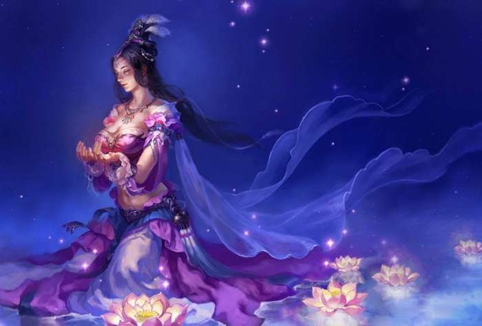
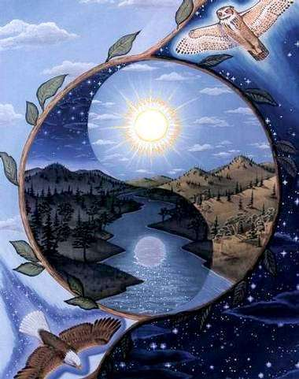

# Жинхэнэ гоо үзэсгэлэн...

Өнөөдөр бид, бараг мэндэлмэгцээ, бие биенийхээ гадаад төрхийг онцлон, “ Сайхан харагдаж байна. Турчихаж”, “Пөөх, таргалчихаж” гэх мэт урамын үг үү, эсвэл шүүмжлэл үү мэдэгдэхгүй “хачин” үгс шидэлцдэг нийгэмд амьдрах юм. Хэвийн жин хэзээд сайхан, гэсэн ч хэн хэнийхээ тарган туранхайг онцолж, тухайн шалтгааныг нь мэдэхгүй байж, сэтгэхүйд нь халдах зөв үү? Магадгүй, тэр хүн, өвдөж зовж, өвчний улмаас тийм байдалд орсон бол, сэтгэл санаанд нь ямар байх вэ? Биеийн жин, бие галбирт хэт анхаарцгаан олон чухал асуудлууд, тэр дундаа хүн, хүний мөн чанар, хүн чанар, оюунлаг чанар, оюун ухаанаа хойш тавиад байна бус уу? Нийгэм тэр чигтээ, “туранхай-сайхан”, “бүдүүн-муухай” гэсэн ойлголтод автчихсан, үүнийгээ хэвлэл мэдээлэл, мэдээлэл харилцааны бүх хэрэгслүүдээр цацаж, бүгд төгс биетэй байх ёстой юм шиг тулган хүмүүсийн сэтгэхүйгээр тоглож байна. Энэ нь, нийгмийн олонхи болох, төгс бус биетэй хүмүүсийн сэтгэхүйд муугаар нөлөөлж, өөртөө итгэлгүй болох, өөрийгөө үнэлэхээ болих гэсэн өөрийгөө бүрэн нээж, бүтээлчээр амьдрахад нь хүртэл хор нөлөө үзүүлэх уршиг дагуулж, өсвөр насныхны хувьд энэ нь бүр сэтгэхүй бүү хэл сэтгэцэд нь эмгэг үүсгэх хэмжээнд ороод байгаа нь нууцгүй юм. Төгс зүйл байдаг ч, маш ховор байдаг гэдэг. Тэгвэл тэр, ховор, төгс биетэй хүмүүстэй адил болох эрмэлзэлийг сэтгэл оюунд суулгах хэнд ашигтай вэ? Сайн бодоорой... Түүнээс эрхэм чухал зүйлс, хорвоо дэлхийгээр дүүрэн байдаг бөгөөд гадаад үзэмжээс илүү дотоод ертөнц маань илүү чухал юм. Хүн, хүн байх, мөн хүний үнэлэмж нь юугаар ч үнэлшгүй зүйл бөгөөд бидний гадаад үзэмжтэй ямар ч холбоогүй байдаг. Хүний хамгийн гол чанар, хосгүй гоо үзэсгэлэн бол түүний сайхан сэтгэл, нүдэнд нь гэрэлтэх оч, мөрөөдөлдөө хүрэх чадвар, сайхан харьцаа юм. Гадаад төрхөөс илүү дотоод сэтгэхүйгээ сайхан болгоход, эрч хүч, оюун сэтгэл, цаг зав аа зарцуулмаар... Жинхэнэ гоо үзэсгэлэн бол, хүн бүрийн дотор оршдог, бидний хүн чанар юм.
