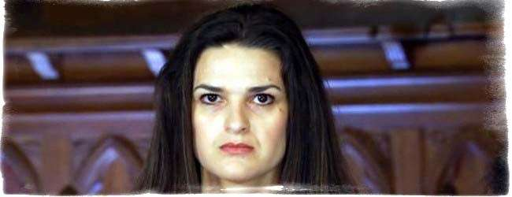
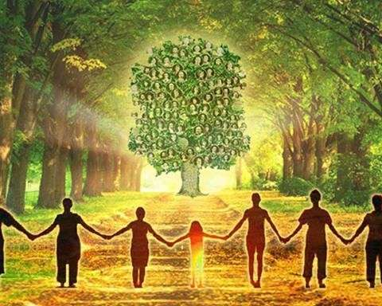

# Зөн билгийн тулааны ялагч, Виктория Райдос: Удмын энергиэ хамгаалах арга

Алдаа хийдэггүй хүн хэзээ ч, хаана ч байдаггүй. Гэтэл энэхүү алдаанууд хэнд ч анзаарагдахгүй удам дамжин амьдралд нөлөөлөх боломжтой байдаг. Иймэрхүү, үеэс үед дамжсан амьдралд давтагдах таагүй нөхцөл байдал зарим гэр бүл, хүмүүс дээр анзаарагддаг бөгөөд үүнийг “удмын хараал” гэж нэрлэх нь ч байдаг.

Виктория Райдос, үхэгсэдтэй холбогдох чадвартай, өвөг дээдэс, удмын санг их хүндэтгэдэг, энэ асуудлаар, амьдралынхаа туршид олон хүнд тус болсон, амьд хүмүүсийг амар амгалан, жаргалтай амьдрах, талийгаач нарыг амарлингуйд хүргэхийг чухалчилдаг, тэрээр, өршөөл уучлалыг дээдлэн үзэж, зөв амьдралын хэв маягийг эрхэмлэснээр энэ асуудалд цэг тавьж болно гэж үздэг байна. Виктория, тухайн удмын хэн нэгний гаргаж байсан алдааг, энэ үеийнхэн нь хэрхэн засаж залруулах талаар дараах зөвлөгөөг өгсөн бөгөөд ялангуяа, урд үеийнхний алдааг дагасан азгүйтэл нь, тухайн гэр бүлд давтагдаж байгаа тохиолдолд, хамгийн түрүүнд хийх ёстой зүйл нь, амьд сэрүүн байгаа эсвэл энэ хорвоод байхгүй эцэг эх, өвөг дээдэс салшгүй холбоотой, нөлөөтэй байдаг гэдгийг ойлгож, тэднийг өршөөж уучилах, тэднээс өршөөл эрэх хэрэгтэй гээд, энэ нь, жинхэнэ буян болдог, мөн, өмнөх үеийнхнээ нүглээс чөлөөлж амарлингуйд хүргэдэг гэжээ. Ялангуяа энэ нь, эцэг эхтэй, тэдний эцэг эхтэй, хүмүүсийн хүүхэд настай ихээхэн холбоотой байдаг гэнэ. Өнгөрснөөс татгалзахгүйгээр, тэдний амьдралд нь, тохиолдож байсан алдаа дутагдал, азгүйтэлийг нь уучлах хэрэгтэй болдог бөгөөд өнгөрсөн үеийн, алдаа, азгүйтэл хүний тархинд сууж, ижил төстэй, тохиолдлын алдаа азгүйтлийн үед, хүн үүнийг холбон бодож, улам сэргээн амьдралдаа хор уршиг дагуулснаар удам дамжсан гэсэн ойлголтод хүргэдэг. Түүнчлэн, хүн өөрөө, эцэг эхийн өмнө буруу үүрэх нь ч мөн даамжиран амьдралд нөлөөлөх чадвартай байдаг гэжээ. Энэ бүхэн нь, хүнийг дэмжиж тэтгэдэг удмын энергийг сулруулж, тасрахад хүргэдэг. Тиймээс, цаг тухайд нь өршөөж уучилах, эсвэл өршөөл эрж байх хэрэгтэйг анхааруулжээ. Тэр, эцэг эх, өвөг дээдэс, удам судраа хүндлэн дээдлэхийг амьдралын гол чухал зүйл гэж үзээд, эцэг эхээ, таныг энэ ертөнцөд төрүүлсэнийх нь төлөө ямар ч байсан, хэн ч байсан уучилснаар удмын энергиэ сэргээдэг. Мөн эхнэр, нөхрүүд харилцан хүндлэлгүй байснаар, гэр бүлийн холбоо нь, удмын энергийн хамт мөхдөг гэж үздэг байна. Тэрээр, “Би, хэрэв нөхөр минь зөвшөөрөөгүй бол, зөн билгийн тулаанд оролцохгүй байх байсан. Эхнэр нөхрийн шийдвэр нэг байхгүй бол энэ холбоо мөхдөг” гэж хэлсэн бөгөөд гэрлэх үедээ эцэг эхийн зөвшөөрөл чухал байдаг болохыг анхааруулжээ. Энэ нь цаашдын амьдралд ихээхэн нөлөөлдөг гэж, тэр үздэг. Удмынхаа талаар сайн мэдлэгтэй байх, таагүй зүйлсэд нь хэт анхаарахгүй байх, урдны амьдралын таагүй зүйлсийг санаж дурсах нь бодол санааг тань булингартуулдаг, харин үүний оронд зөв амьдарч, өвөг дээдсийнхээ дурсгалыг хүндэтгэж, бүхнийг өршөөж, сайнаар дурсаж, хажуудаа байгаа мэт хүндэтгэн хайрласнаар удмын дэмжлэг авна гэж зөвлөжээ.
