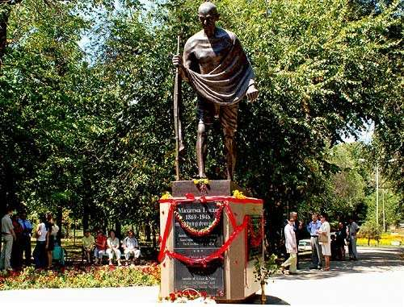
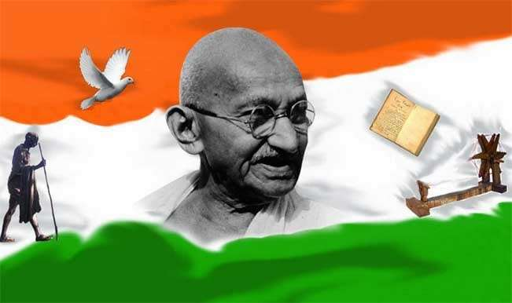

# Зоримог, шударга, ухаалаг удирдагч

Энэтхэгийн улс төрч Ганди, амьдралын талаар хамгийн зөв ойлголттой хүн байв. Түүний улс орноо удирдаж байсан үед, энэтхэг орон маш ядуу зүдүү амьдралтай байв. Ганди ч, мөн бусдын адил амьдарлаар амьдарч, ердийн даавуун үндэсний өмсгөл болох хэрчим даавуу, задгай шаахайнаас өөр зүйл өмсөхгүй, эх орон нэгтнүүдийнхээ адил амьдарна. Нэг удаа, түүнийг Английн ерөнхий сайд Черчилль, англид ярилцлаганд урьжээ. Өмсөж зүүснийг нь харсан Черчилль түүнийг -Та, бусдын адил манай соёл, заншилд таарахуйц хувцасласан байх ёстой гээд хүлээн авсангүй. Үүнд, Ганди, -Та өөрийн орны, эдийн засгийн байдлаа мэднэ. Мөн та, өөрийн орны уламжлалаар хувцаслахад таны хувьд асуудалгүй. Харин миний хувьд, би Энэтхэг улсыг төлөөлж байгаа, би эх орон нэгтэнүүдийнхээ адил эдийн засаг нөхцөл байдлынхаа түвшинд хувцасласан. Энэтхэгчүүд энэнээс илүү хувцаслаж чадахгүй байгаа. Би ч, мөн тэгж л хувцаслах ёстой, гэж хариулсан бөгөөд Черчилль түүнийг хүлээж аваагүй тул буцсан гэдэг. Түүний энэ үйлдлийг энэтхэгчүүд хайр хүндэтгэл дүүрэн хүлээн авсан бөгөөд харин, Черчиллийн үйлдэл, англид ард иргэдийнх нь дургүйцлийг төрүүлсэн аж. Тиймээс, англичууд, Гандиг дахин урьж уг хувцастай нь хүлээн авахад, Ганди, -Ноён Черчилль, Та надтай ярилцахаас биш миний хувцас хунартай ярилцахгүй биз дээ, гээд үргэлжлүүлэн, -Та, ямар ч ач холбогдолгүй дэмий зүйлд ач холбогдол өгөх юм. Та баян хүн, Та гарамгай улс нийгмийн зүтгэлтэн, гэвч Та, амьдралын жинхэнэ үнэ цэнийг мэдэхгүй байна, гэж ярилцлагаа эхлүүлэхэд, Черчилль дуу гарч чадаагүй гэдэг. Тэр ярилцлагад оролцсон, Оксфордын их сургуулийн хүндэт ректор нэгэн эрхэм, -Ганди маш аюултай хүн юм. Тэр хэдий, ядуу, хэн ч биш ч гэсэн, түүний энэ жижигхэн биед, долоон давхар торны цаана суулгасан ч, тамлан зовоосон ч, өөрийн үзэл бодолдоо үнэнч байх, гайхалтай их хүч, оюун сэтгэлгээний хүч байна. Бид түүний биеийг дийлж болох ч, бодол санааг нь дийлэхийн аргагүй хүн юм, гэж бичиж байжээ.\
Манай удирдагчид, хамгийн үнэтэй, брендийн хувцасаар гангарч, хөгжингүй орнуудын удирдагчидтай хувцасаараа өрсөлдөж, мөн өмнө нь бөхөлзөж байх нь харагддаг. Харин, зоримог, шударга зантай, сэтгэлгээний өндөр чадамжтай удирдагч гэж ийм байдаг ажээ.
