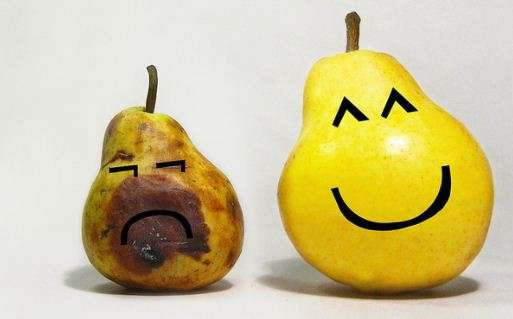

# Зүрх сэтгэлгүй хүн дэргэд тань байгааг илтгэх 7 шинж

Хорвоо ертөнц дээр сайхан сэтгэлтэй хүмүүс амьдардаг нь сайхан хэрэг юм. Гэвч, сайн зүйлд саараар хариулах дуртай, түүнийгээ өөрөө ч мэддэггүй, хорвоо дээр ганцаар бүхнийг эзэгнэх сувьдаг сэтгэлтэй, бусдыг өөрөөсөө дор байлгах дуртай хүмүүс мөн байдаг. Тэд чонын арьс нөмөрсөн хонь мэт байдгаас, таньж мэдэх түвэгтэй байдаг. Ийм хүмүүс, их сайн харагдахыг хичээж, дүр эсгэн амьдардаг бөгөөд тэдний үйлдлийн цаана, хар хор, атаа жөтөө, шунал, бусдаас дээр байх гэсэн харалган хүсэл, бүхнийг эрхшээх ханашгүй сувьдаг сэтгэл нуугдаж, орчиноо хордуулж байдаг аж. Тэднийг таних зарим шинж тэмдгүүд:

1. Тэд, аливааг гуйвуулах гарамгай авъяастай байдаг. Хүсвэл өөрийн чинь үгийг, эргүүлэн зэвсэг болгон гайхтал тань ашиглана.\
2. Тэд аливааг төөрөгдүүлэхдээ сайн. Хүсвэл, ялааг заан болгох, зааныг ялаа болгон хувиргах чадвартай. Эргэн тойронд болж буй зүйлсийг өөртөө ашигтайгаар эргүүлэхийн тулд худал хуурмагаар ойлгуулж итгүүлэн үнэмшүүлэх бүх аргыг хэргэлдэг. \
3. Тэд уснаас хуурай сугарахын тулд, худал ярихдаа гарамгай. \
4. Алдаа дутагдлаа хүлээх дургүй. Өөрийн хийсэн үйлдэлдээ хариуцлага хүлээхгүй, зөвхөн бусдыг буруутгаж, өөрийн бүхий л асуудлуудынхаа бурууг бусдад тохож байдаг. \
5. Буруугаа хүлээх, гэмших сэтгэл байдаггүй. Хүний амьдралыг устгаж сөнөөхдөө огт санаа зовохгүй. Хүнийг огт бодохгүй зөвхөн өөрийн сайн сайхныг бодож, хамгийн дээр байхыг хүсдэг. \
6. Таны аз жаргал, амжилт түүнд огт сонирхолгүй. Өөрт нь ашигтай бол сонирхох ч, өөрөөсөө дээр гарахыг тэвчихгүй. Тэд хэнийг ч аз жаргалтай байгааг харж чаддаггүй, бухимддаг. Бусдын талаар олигтой зүйл ярих нь ховор, яривал, атаархлын үүднээс хов, гомдлын хэмжээнд ярина. \
7. Тэд, бодит байдлыг байгаагаар нь хүлээж авч чадахгүй. Харин зөвхөн өөрт нь таалагддаг байдалд байхыг хүсдэг. Тэдний хүсэл, өөрийгөө төгс байдалд байлгаж, бусдыг аз жаргалгүй байхыг харах. Ийм маягаар тэд, өөрийн сайн сайхны төлөө яахаас ч буцахгүй үйлдлүүд гаргаж байдаг бөгөөд хамгийн аймшигтай нь тэд, хүнийг хэн ч биш болгох чадвартай байдаг нь юм. \
Эдгээр хүмүүс долигонуур зантай, олон ааштай байдаг ба зайлсхийх, зайгаа барих үйлдлийг тань яаж ч эргүүлэх заль мэхээр дүүрэн байдаг. Таньж мэдсэн тохиолдолд, зайлсхийж холдохоос өөр арга үгүй, тэд, хэзээ ч засрахгүй хандлагатай байдаг байна.
