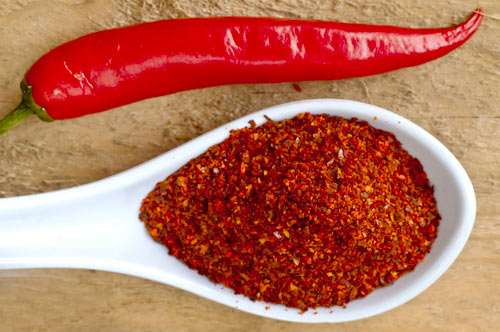

# Зүрхний шигдээсийг 1 минутад зогсоох арга ба зүрхний өвчинд хэрэглэх бэлдмэл

Энэ аюулт өвчнийг, 50 секундэд зогсоох аргыг, өвс ургамлын эмчилгээний аргачлалаар нэрд гарсан, эмч Джон Кристофер олон зуун туршилт судалгааны үндсэн дээр, энэ өвчлөлд, зөвхөн кайены улаан чинжүү тусалдаг бөгөөд мянгаар тогтгохгүй өвчтөнүүдийг аварсан гэж батлан, хэрэглэх аргачлалыг зааж зөвлөсөн байна.

Улаан чинжүү нь, халапеньо, ямайн халуун чинжүү, мөн кайены гэсэн төрлүүдтэй байдаг байна. Кайены чинжүү Энэтхэг, Өмнөд америкт ургадаг. \
Хэрэв хэн нэгний цээж хүчтэй өвдөж, шигдээсийн шинж тэмдэг илэрвэл, яаралтай 1 цайны халбага кайены улаан чинжүүг аяга усанд хутган уулгах хэрэгтэй. Энэ үед өвчтөн ухаан алдаагүй байх үе юм. \
Харин ухаангүй унасан байгаа тохиолдолд, кайен чинжүүний ханднаас хэдэн дуслыг хэлэн доор нь түрхэж өгөхөд үйлчлэл явагдна. \
Кайены чинжүү нь маш хүчтэй өдөөх чанартай бөгөөд зүрхний агшилтын давтамжийг нэмэгдүүлж, цусыг бие организмаар түргэн шахаж тараах боломжтой болгодог байна. Түүнээс гадна. дотуур цус алдалтыг маш хурдан зогсоох үйлчлэлтэй ажээ.

---

Мөн зүрхний шигдээсээс урьдчилан сэргийлэх, мөн л кайены чинжүүн дээр суурилсан германы бэлдмэл байдаг байна.үүнийг доктор Шульцын жор гэдэг.

#### Орц:

-нунтаг кайены чинжүү /лонхны ¼ /\
- 1-3 ширхэг кайены чинжүү /бүтнээрээ/\
-50%-н спирт эсвэл архи\
-1 литрийн шилэн лонх\
-резин бээлий

#### Бэлтгэх:

-Бээлийгээ өмсөж, лонхны ¼ байхаар нунтаг чинжүүгээ лонхондоо хийнэ\
-дээрээс нь чинжүүг, дөнгөж давахаар архи хийнэ\
-бүтнээрээ байгаа шинэ чинжүүгээ, багахан архитай хамт холигчид соус маятай болтол хутгаад, лонхондох, архитай нунтаг чинжүүн дээр хийнэ. \
-лонхтойгоо сэгсрээд, дээрээс нь дүүртэл архи хийж тасалгааны температурт, нэг өдөр байн байн сэгсрэх маягаар тавьна. \
-хоёрдох өдөр нь, харанхуй газарт шилжүүлэн тавьж хоёр долоо хоног байлгаад шүүнэ. \
-хатуу болох тусмаа сайн. 3 сар харанхуй газар тавиад бэлэн болно. \
Өдөрт, зүрхний өвчний үед 5-10 дуслыг хэрэглэдэг. \
Мөн кайены чинжүү нь, мөөгөнцрийн эсрэг үйлчлэлтэй ба хоол боловсруулах системийн үйл ажиллагааг сайжруулахаас гадна хорт хавдарыг /уушигны хорт хавдарт илүү нөлөөлдөг/ эмчлэх чадвартай юм байна. Чинжүүнд байдаг капсацаин нь тамхинаас гарсаны дараах үеийн уушигны асуудлуудыг бүрэн шийдэх чанартай гэнэ.

Та шууд л дэлгүүр явж чинжүү авмаар байгаа. Сайн судалж, мөн эсэхийг нь шалгаж байж аваарай.
