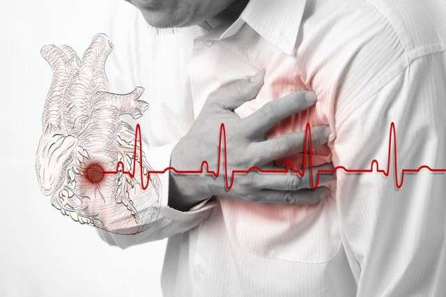
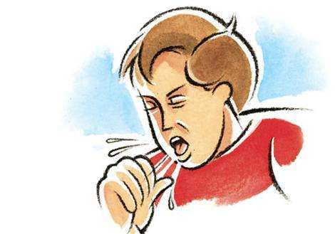

# Зүрхний шигдээсийн үед, өөрийгөө аврах арга

Зүрхний шигдээс ихэвчлэн, хүн ганцаар , тусламж авч чадахааргүй үед тохиолдох нь элбэг байдаг байна. Явц нь маш хурдан, 10 хором л явагддаг.

Ямар ч тохиолдолд, зүрх тань эвгүй болж, хүчтэй өвдөн юу юугүй ухаан алдах нь гэсэн мэдрэмж төрж эхлэвэл, уртаар, дотогш, гүнзгий амьсгаа авч, зогсоо зайгүй хүчтэйгээр ханиалгах хэрэгтэй. Цээжний тань гүнд байгаа, нойтон цэрийг ховхлох гэж байгаа юм шиг, цээжний угаас, үргэлжлүүлэн ханиалгаарай. 2 секунд тутам, амьсгаа авч зогсолгүй, эмнэлгийн тусламж иртэл эсвэл зүрх тань хэвийн ажиллаж эхэлтэл ханиалга.\
Уртаар гүнзгий амьсгаа авах нь, уушгинд очих хүчил төрөгчийг нэмэгдүүлж, харин ханиалга нь, зүрхийг ”шахаснаар”, цусыг тараан, зүрхийг ажиллуулж эхэлдэг байна.\
Энэ арга нь, зүрх муутай хүмүүст, түргэн тусламж хүлээх, эмнэлэгт очих боломж олгох, үнэт цаг мөчийг өгдөг бөгөөд үүнийг мэдсэнээр олон хүний амь аврагдах болно.
