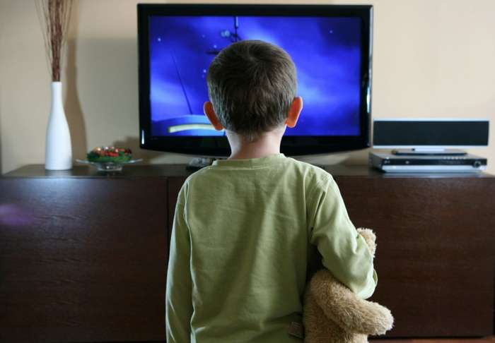
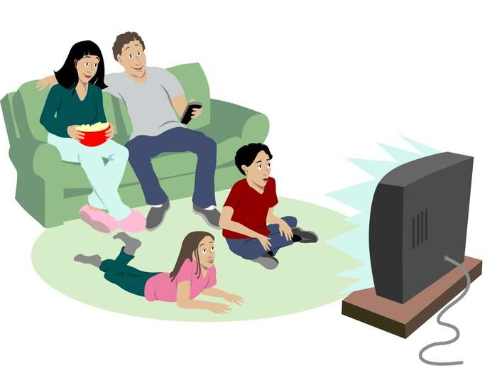

# Зурагт, хүүхдэд сөрөг нөлөөтэй

Стаффордширын их сургуулийн хэсэг эрдэмтэд, зурагт үзэх нь хүүхдийн эрүүл мэндэд хэрхэн нөлөөлдөг талаар хийсэн туршилт, судалгааны үр дүнд хүүхдүүдийг урт хугацаагаар зурагт үзүүлэх нь, хүүхдийн сэтгэхүйд муугаар нөлөөлж, аливааг сурах, бүтээх оюуны чадвар нь буурдаг болохыг тогтоожээ.

Туршилтын үед, хүүхдийг 15 минутаас дээш зурагт үзүүлэхэд, бүтээлч санааны болон ойлголтын чадавхи нь илт буурч байгаа нь ажиглагджээ. Хэдийгээр, хэсэг хугацааны дараа эдгээр чадавхиудын сэргэлт явагдаж байсан боловч, эрдэмтэд, хүүхдэд зурагт үзүүлэх нь, хүүхдийн сэтгэхүй болон бие мах бодын эрүүл мэндэд, сөргөөр нөлөөлдөг гэсэн дүгнэлтэд хүрсэн байна. Тиймээс, хүүхдийнхээ, зурагт үзэх хугацааг, хянахгүй орхигдуулвал, цаашид, оюун ухааны хөгжил нь саарах эрсдэлд хүрч болохыг анхааруулсан байна.
