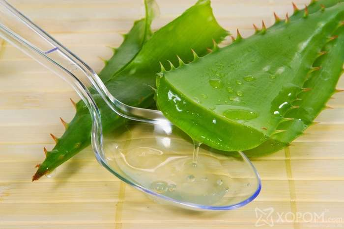

# Зуун настын эмчилгээний шид

Зуун настын шүүс олон тооны өвчнийг анагаахад тустай.

• Сүрьеэтэй хүүхдэд нэг цайны халбага зуун настын шүүсийг сүүтэй хольж, өдөрт гурван удаа 20-25 хоногийн турш уулгахад хүүхдийн жин нэмэгдэн хоолонд сайжирч, халуун нь бууран цусан дахь цагаан бөөм нь нэмэгддэг байна.\
• Түүнчлэн элдэв шарханд зуун настын навчны хальсыг наах буюу жижиглээд хоёр цагийн зайтай түрхэж эмчилнэ. \
• Хоолой, төвөнхийн өвчний үед зуун настын шүүсээр зайлах, түүний шүүсэн дээр бага зэрэг ус нэмээд хоолны халбагаар өдөрт 3 удаа хоолой дээрээ тогтоон зайлах байдлаар хэрэглэнэ. \
• Ходоод арван хоёр нугалаа гэдэсний шарх, элэг, цөсний зарим архаг, өвчин, хоолны шингэлт муудах зэрэгт зуун настын шүүсийг дарс, вино, зөгийн бал, элсэн чихрийн аль нэгтэй хольж хэрэглэнэ. \
• Шүдний болон буйлны өвчний үед зуун настын навч зажлах, шүүсээр нь зайлахад намдаах үйлчлэлтэй. \
• Зуун настын навчийг элдэв шархан дээр тавих, шүүсээр арчих, арьсны идээт өрөвслийг хөхүүлэхэд сайн нөлөөтэй.
