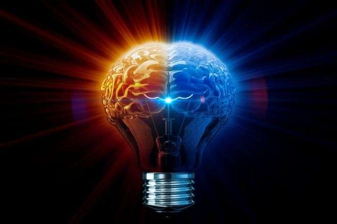
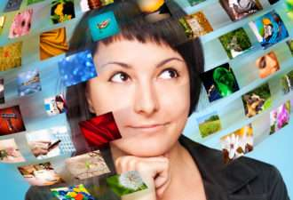

# Зөв бодол  шинэ амьдралыг бүтээдэг

Дараах бодлыг уншаад, хичнээн хувь нь таны бодолтой таарч байгааг үзээрэй. Төгс зөв бодол гэж томъёологдсон зүйл үгүй ч энэ хүний бодол олон зүйлийг тайлна.

Би төрсөн минь, байж байгаа минь гайхамшиг. Би ургамал, амьтан шиг биш. Би сэтгэдэг, боддог, баярладаг, гуньдаг, ярьдаг, сонсдог, хүсдэг, зорьдог, энэ бүхнийхээ төлөө бүхэнд талархдаг. Би гэр бүл, ээж аав, үр хүүхэд, хайртай хүн, найз нөхөд, таатай, таагүй хүмүүс, мөн гэр орон, олсон туршлага, бодол санаа, мэдрэмж, сэтгэл хөдлөл, азгүйтэл, амжилт, нар, бороо, өдөр цаг хором бүрийг байгаад, эдгээрийг өөрийн нүдээр харж чадаж байгаадаа, мөн өөрт байгаа бүхнийхээ төлөө хорвоод талархдаг. Би, хамгийн түрүүнд өөртөө итгэдэг. Энэ бол хамгийн чухал амьдралын хууль юм. Хүн өөртөө итгэж эхэлсэн тэр хормоос эхлэн амьдрал гайхалтай сайхан болдог. Би, амьдралд хайртай, хором бүрт баярладаг. Амьдрал ганц л олддог. Тиймээс, түүнийг дэмий нөхцөөх, уйтгарлах, гунихад зарцуулах нь дэндүү хайран. Зорьсон зүйлтэй байж, түүндээ тэмүүлж амьдардаг. Надаас амжилтын гэгээ цацарч байгаа. Амжилтад итгэж чадсан хүн л түүнд хүрдэг. Ийм хүнээс бүр амжилт үнэртэж байдаг. Хүссэн бүр минь биелж, хэрэгцээ шаардлага минь хангагддаг. Намайг, хорвоо ертөнц, Бурхан үргэлж харж, дэмждэг. Ертөнцийн үнэт зүйлээ би мэддэг. Хүн бүр төрөх үедээ аз жаргалыг эдлэх бүхий л чанаруудаар дүүрэн төрдөг. Тиймээс бяцхан хүүхдүүд, уйтгар гуниггүй, дүнсгэр биш бүгд баяр баясгалантай аз жаргалтай байдаг ч, хүүхдүүдээс тун цөөхөн нь энэхүү аз жаргалд итгэх төрлөх чанараа хадгалан өсдөг нь харамсмаар... би бол ертөнцийн гайхамшиг, давтагдашгүй нэгэн, Бурханы бэлэг. Хүний далд ухамсар, гадаад ухамсараас хавьгүй илүү хүчтэй. Ухамсар, хүний туулж өнгөрүүлсэн амьдралын алдаа азгүйтэл, зарчим, туршлагаар хязгаарлагддаг. Харин далд ухамсар юугаар ч хязгаарлагддаггүй. Би өөрийн санаа бодлын эзэн. Би, өөрийн амьдралыг бүтээн байгуулагч. Миний бодлууд, миний өөрийн ертөнцийг бүтээгч. Би тэмцэлдэхийг хүсдэггүй, тайван байж хүсэл мөрөөдлөөсөө ухардаггүй. Боломжгүй зүйл гэж үгүй. Хүн бүхнийг хийж чадна. Зөвхөн өөртөө л итгэ. Өдөр бүр өөрийгөө сайжруул. Хийхэд хэцүү байсан зүйлээ, хэсэг хугацааны дараа харахад, энэхүү амархан зүйл яагаад хүчиндээ эргэлзэхэд хүргэснийг гайхан бодоход хүргэж байдаг. Аливаа зүйлийн төгсгөл, шинэ зүйлийн эхлэл болдог. Төгсгөл яг л тэнгэрийн хаяа шиг, дөхөөд очихоор тэлсээр байдаг. Үхлийг би ийм зүйл гэж боддог.
