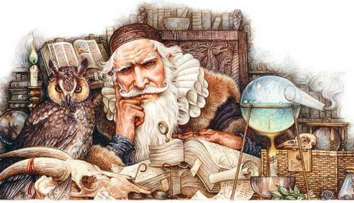
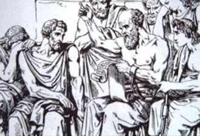

# Зөв хүлээн авалт

Хүмүүс, эртний мэргэд, гүн ухаантнуудыг ихэд хүндэтгэн хүлээж авдаг ч, яагаад ч юм тэдний бичсэн зүйлс, зохиолуудыг унших нь ховор байдаг. Хэрэв та номын дэлгүүрийн “сонгодог зохиол” хэсгийн тавиураас унших зүйлээ сонгож авдаг бол, таны урт удаан аз жаргалтай амьдрах боломж өсч байдаг гэнэ. Үзэл санаа, сэтгэл бодол л, зөвхөн аз жаргалтай, сэтгэл хангалуун амьдралыг өгдөг гэсэн мянга мянган жилийн турш нотлогдон ирсэн агуу зүйлсийг та эдгээр бүтээлүүдээс л уншиж чадах юм. Биднийг, бидэнд тохиолдож буй таагүй зүйлс, тохиолдол, үйл явдал гутрааж, зовоож байдаг бус, харин бидний итгэл үнэмшил, аливааг хүлээн авах үзэл бодол, сэтгэл санаа л гутрал, зовинолд хүргэж байдаг байна. Жишээ нь, хэн нэгэнд хаягдсан хүн, тухайн үедээ гуньж гутран, амьдрал дахиж хуучин хэвэндээ орохгүй юм шиг санаж, зовно. Гэтэл тэр үгүйлэн буй хүн нь, засаршгүй гэмт хэрэгтэн муу хүн гэдгийг мэдэх, эсвэл хамтын амьдралын хэсэг хугацааны дараа өөрт нь ихээхэн муу зүйл хийх, муу үр дагаварт хүргэхийг харж мэдвэл огт зовох мөн үгүйлэхээ больж, багахан айж, бүр холдсондоо баярлана. Тиймээс, үйл явдал өөрөө чухал биш харин түүнийг хүлээн авах үзэл бодол хамгаас чухал болох нь үүнээс харагдна. Эртний гүн ухаантнууд, сайн, муу үйл явдал гэж байхгүй, зөвхөн болж буй зүйлийг хүлээн авах сайн муу хүлээн авалт гэж байдаг, мөн сайн, муу бодол санаа гэж байдаг хэмээн сургадаг. Жишээ нь, “Энэ зүйл надтай тохиолдлоо”, эсвэл “Энэ зүйл надтай тохиолдлоо, аймаар зүйл” гэсэн хоёр хүлээн авах хандлагын хоёрхон үгийн зөрүү тухайн тохиолдлыг, эхнийх нь болоод өнгөрөх зүйл, хоёрдох нь тухайн тохиолдлыг хэцүү зовлонт зүйл болгон хувиргаж хүн өөрөө зовж эхэлдэг байна. Мөн өөрийн хянаж чадах зүйлээ ялгаж салгаж, хүч хүрэхгүй зүйлд санаа зовохгүй байх нь тун чухал. Өөрчилж чадахгүй зүйлээ байгаагаар нь хүлээн авч чаддаг болохын тулд “Би үүнд нөлөөлж чадах уу?” гэсэн асуултыг өөртөө тавьж, хэрэв “тийм” гэж бодогдож байвал, зовинож сандрахын оронд, тухайн зүйлээ гардан барьж авч хийж эхлэх, хэрэв үнэхээр нөлөөлж чадахааргүй зүйл бол, хэрэггүй шаналахын оронд зайлсхийх, өөр гарцыг хайж эрэлхийлэх хэрэгтэй. Бидний үйлдэл, яриа нь тархин дах бодлын маань үр дагавар бөгөөд аливааг эерэгээр харж, байгаагаар нь хүлээн авснаар амьдрал, асуудлууд хөнгөвчлөгдөн амар болдог ажээ.

