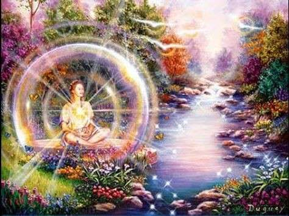

# Зөв хүний шинж тэмдэгүүд

Та, хувь хүнийхээ хувьд ямар нэгэн өсөлт дэвшилд хүрч буй эсэхдээ эргэлздэг бол, дараах зүйлийг уншаарай. Жинхэнэ байх ёстой, хүрэх ёстой зүйл рүүгээ зөв явж байгаа бол дараах шинж тэмдэгүүд илэрч байдаг гэнэ.

1. Та, өөрийгөө ойлгох болсон. Энэ нь, та, өсөлтийн шатныхаа аль хэсэгт байгаагаа мэддэг, урагш түлхэх хөдөлгөгчөө мөн мэддэг, хязгаарлагч хүчин зүйлсийг мэддэг, асуудлуудаа нарийвчилан шинжилж чаддаг, өөрийнхөө орчинд хамгийн сайн уур амьсгалыг бүрдүүлэхээр шийдвэр гаргаж сонголт хийж чаддаг болсоныг хэлнэ. Мөн, урдын адил алдаа гаргадаг боловч, буруугаа бусдад тохдоггүй, түүнийгээ өөрийгөө хөгжүүлэхэд хэрхэн ашиглаж болох талаар ойлголттой болсон байдаг. Болж буй бүх зүйлс, өөрийн тань хариуцлагаас шалтгаална гэдгийг мэддэг, ямарваа зүйлийн золио, барьцаа биш гэдгээ бүрэн ухамсарладаг, хувийн амьдралаа өөрөө тодорхойлж, чиглүүлж чаддаг, аливаа зүйлд шалтгаан талаас нь ханддаг, тиймээс зөв шийдвэр гаргаж чаддаг байдлуудыг өөрийгөө ойлгодог болсны шинж гэж үздэг.\
2. Та, бүх шаардлагатай мэдлэг, мэдээллүүд дотор сэтгэл дотор тань буйг мэдэрч эхэлсэн. Хүн өсч хөгжихийн тулд гадны мэдээлэл, судалгаа шинжилгээнд ихээхэн хүч заваа зарцуулж байдаг. Харин, юу чухам урагшлах хөдөлгөөнд саад болоод байгааг болон амьдралын бүхий л зүйлсийн хоорондын уялдааг, ухамсар тань, дотроос тань дэлгэх нэгэн цаг мөч ирдэг. Та, бүх болж буй зүйлсийн учир шалтгааныг мэдэж, хэрэгтэй бүх зүйл дотор тань байгааг мэдсэн байдаг.\
3. Та өөрийгөө үнэлж чаддаг болсон. Та, өөрийгөө төгс хүн биш гэдгээ мэддэг. Тиймээс, тийм байхын төлөө үр ашиггүй оролдлогууд хийдэггүй. Бусдад туслах сэтгэлтэй, хэзээ хэнд туслахаа, хэзээ зайлсхийхээ мэддэг, учир нь, өөрийн тань хүсэл, хэрэгцээ хамгаас чухал болохыг ухамсарладгаас бүхнийг тохируулж сурсан мөн, та, энэ ертөнцөд ирэхдээ, тодорхой нэгэн зорилгын тулд ирсэн, харин бусдын хүслийг биелүүлэхийн тулд ирээгүй гэдгээ ойлгодог, хэн нэгэн, өөрийн хүслийг тулгавал, хэмжээ хязгаар тавьж, тухайн хүнийг өөрийнхөө замаар явахын чухлыг ойлгуулах, чиглүүлж чаддаг болсон байдаг. Гэхдээ, хүн өөрийгөө таних, өөрийгөө хөгжүүлэх цаг заваар хомс болж, өөр бусад хүмүүсийн хэрэгцээ шаардлагын төлөө ажиллах байдал ихэссэн энэ үед, бусдад туслах нь, өөрийгөө мэдрэх, эрч хүчтэй байх, хайр, талархлыг авах боломж болж өгдөгийг мартаж болохгүй юм.\
Эдгээр шинж чанарууд танд, илэрч байгаа бол та, хэн байх ёстой, мөн хүрэх зүйл рүүгээ зөв явж байна гэдэгтээ итгэлтэй байж болно. Таны дотор, энэ ертөнцөд амьдрахад тань хэрэгтэй бүх зүйл байдаг, түүнийгээ нээхийн төлөө, өөрөөрөө байхыг хичээгээрэй.
