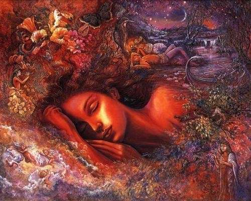

# Зөв нойрсох талаар өгдөг, Аюрведийн зөвлөгөөнүүд

1. Унтахын өмнө хөлөө бүлээн усанд угааж тосолж байх. Хэрэв өдөр бүр, энэ маягаар хөлийн уландаа гүнжидийн тос, болон бусад ургамал цэцгийн тосоор массаж хийдэг бол хэзээ ч өвдөхгүй

2. Унтахын өмнө амьсгалын дасгал бясалгал хийх маш сайн

3. Хувцастай унтах ялангуяа оймстой унтаж болохгүй

4. Толгойгоо зүүн тийш харуулж унтах хамгийн сайн

5. Унтах үед хоол хүнсний үнэр байлгахгүй байх

6. Нүүрээ хөнжлөөрөө хучиж унтахгүй байх

7. Нойтон чийгтэй ор дэрэнд огт унтаж болохгүй

8. Зуны цагт задгай агаарт унтах сайн

9. Хажуу тийш харж унтах сайн. Зүүн хажуугаараа унтах хоол боловсруулах эрхтэний үйл ажиллагаанд сайн, баруун хажуугаараа унтах сайн амрахад тустай. Зүүн хажуугаараа унтах үед хамрын баруун нүхээр илүү амьсгалдаг тул, биед эерэг энерги хуралдуулж, дулаацуулдаг. Хүйтэн сэрүүн өрөө тасалгаанд зүүн талаараа унтдаг.

10. Дээш харж унтахыг тархинд муу гэж үздэг

11. Доош харж унтах хамгийн муу, амьсгалын хэмнэлийг бүрэн алдагдуулдгаас өвчин өвчилөлд хүргэдэг

12. Нойр дутуу байх, огт унтахгүй байх эрүүл мэндэд хортой

13. Эрт унтаж эрт босч бай. Эрүүл мэнд сайжирч, амьдралын эрч хүч нэмэгддэг

14. Нар шингэх үед унтах Өдөр унтах нь, амьсгалын замын өвчилөл, толгойн өвчин зэрэг олон өвчинд хүргэнэ. Хүнд ажлын дараа эсвэл өвчтэй хүн л өдөр унтаж болдог. Өөр бусад тохиолдолд хориглодог

15. Унтахын өмнө хооллох нь хоол боловсруулах эрхтэний үйл ажиллагааг сулруулж биед хор хуримтлагдах нөхцөл бүрдүүлнэ

16. Унтах өрөө хангалттай цэвэр агаартай байх

17. Шөнө ажилласан хүн нойроо нөхөхдөө өглөөд хоол цай идэхгүй унтахыг зөвлөдөг

18. Жирэмсэн эмэгтэйчүүдийг их унтахыг хориглодог. Хүүхэд нь залхуу болно гэдэг байна.

