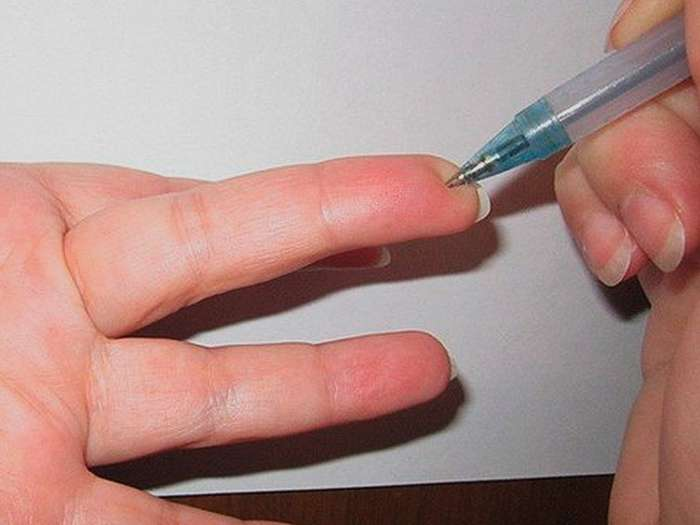
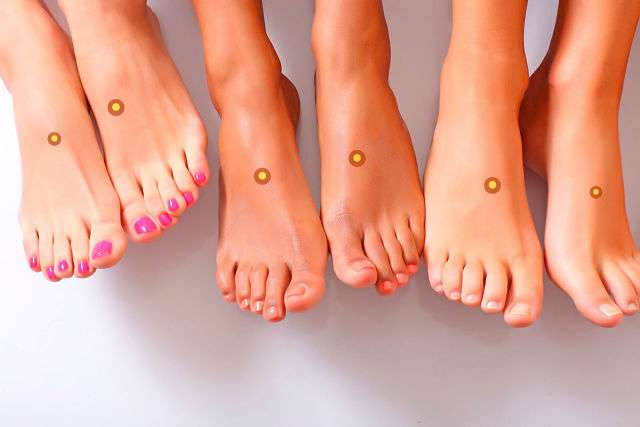

# Зөвхөн нэг цэг дээр дараад даралтаа буулгах арга

Энэ аргыг цэрэг дайны үеийн эмчилгээнд хэрэглэж иржээ. Бие тань хүнд, бүр тэсвэрлэхээргүй хэцүү болвол энэ цэг дээр удаанаар дарах ёстой байдаг байна. Биеийн аль ч хэсэгт өвдөх нь биеийн энергийн урсгал хаагдсанаас болдог аж.

#### Хурууны цэг

Даралт огцом буурч, сэтгэл хөнгөрч, нүд нээгдэх шиг болдог. Хурдтай, үр дүнтэй эмчилгээ хэрэгтэй нөхцөл шаардлагатай байдаг учраас цэргийн эмчилгээнд хэрэглэгддэг байна.\
Энэ цэг, гарын дунд хурууны өндгөн дээр байрладаг. Их өвчтэй байдаг цэг гэнэ. 1 минут орчим дарахад аль ч хэсгийн өвдөлтүүд арилдаг аж.

#### Хөлний цэг

Уур уцаарыг дардаг цэг. Өдөр бүр, 5 минут хоёр хөлийнхөө энэ цэгэнд массаж хийхэд хуралдсан сөрөг энергиэс гаралтай өвчнүүд илааршдаг. Хөлийн тавхайны төвгөр хэсгийн урд талд байрладаг маш өвчтэй цэг учраас андуурах аргагүй байдаг ажээ.
