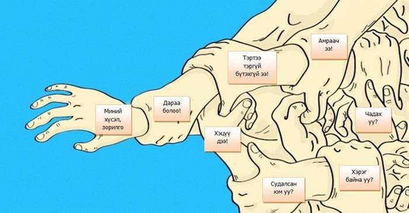

# Зөвхөн өөрийгөө сонсох хэрэгтэйг батлах “ганц дүрэм”

“Crab bucket theory”-“хувинтай наймалжны онол”, манайхаар, “тамын тогооны үлгэр”.

Үндэстэн бүрийн хэл ярианд, хэлц үг болтлоо тархчихсан, хүмүүсийн энэхүү “сөрөг” үйлдлүүд, бидний амьдралын салшгүй нэг хэсэг, бүр хэвшил болсон байдаг нь харамсалтай. Энэ үйлдэл харьцаа бидний өдөр тутмын амьдралд байнга тааралдаж байдаг. Жишээ нь, хүн архи, тамхинаас гарах оролдлого хийх үед, нэг нь “чи юу гэж гардаг юм” “за сүүлийн удаа татчих” “биенд муу” “ хэрэг байна уу”гэх. Үргэлжлүүлэн суралцах хүслийг “тэртэй тэргүй ядарч байж, шаардлага байна уу” “болоо биш үү”, гадаад явбал, “хүний газар хэцүү” “хөлөө олж чадах уу”, шинээр ажил эхлэхэд, “шатав аа” “судалсан уу” “эхлэх ч хэцүү дээ” гэх маягийн сөрөг утгатай, яршигтай үгүүдийг сонсоогүй хүн гэж байдаггүй гэж хэлж болно.

Эдгээр үгс, хүний хүсэл, зорилго, зүрхийг үхүүлэх атгаг хүчийг агуулж, аливаад саад болох уршигтай байдаг. Тиймээс, “тамын тогоо”-ноос гарах хүчтэй байх арга нь, өөрийгөө сонсох буюу “өөрөө, өөртөө зөв”-г баримтлах “дүрэм” гэдгийг ойлгоорой.
